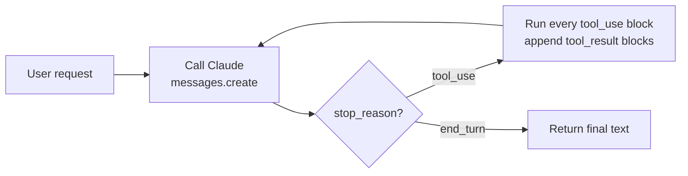

# CCAR-F Exam Study Notes

Nov 13, 2026 · Falaque Dani

Read this top to bottom the day before the exam: about 60–90 minutes. Each domain lists the core ideas, the facts most likely to be tested, and the answer patterns the exam rewards. Spend the most time on Domain 1 (27%) and the traps list at the end.

Source note: Anthropic does not publish the full guide openly. These notes follow the domain weights and task statements reported consistently by third-party prep sites, plus Claude API and Claude Code documentation as of November 2026. Confirm format, fee and timing on your exam registration page.

## Exam format and strategy

The exam is 60 scenario-based multiple-choice questions in 120 minutes; you pass at 720 on a 100–1000 scaled score.

| Item | Detail |
| --- | --- |
| Questions | 60, one correct answer and three distractors |
| Time | 120 minutes (about 2 minutes per question) |
| Pass mark | 720 / 1000 (scaled) |
| Scenarios | 4 drawn at random from a pool of 6; each question sits inside one |
| Guessing | No penalty; an unanswered question counts as wrong |
| Validity | 12 months (reported by one prep site) |

### Domain weights

| Domain | Weight | Approx. questions |
| --- | --- | --- |
| Agentic Architecture & Orchestration | 27% | 16 |
| Claude Code Configuration & Workflows | 20% | 12 |
| Prompt Engineering & Structured Output | 20% | 12 |
| Tool Design & MCP Integration | 18% | 11 |
| Context Management & Reliability | 15% | 9 |

### How to pick the right answer

1. **Prefer deterministic over probabilistic fixes.** If a rule must always hold, the answer enforces it in code: a hook, a gate, a schema, `tool_choice`. "Add a line to the system prompt" is usually the distractor.
2. **Fix the root cause, not the symptom.** A bad tool description is fixed by rewriting the description, not by adding more few-shot examples elsewhere.
3. **Pick the smallest change that works.** Avoid answers that add a new agent, a new model or fine-tuning when a config or prompt change solves it.
4. **Watch for absolute words.** "Always", "never" and "guarantees" in an option about model behaviour are usually wrong; models are probabilistic.
5. **Read the scenario's constraint.** Cost, latency, compliance or "must not" wording usually decides between two plausible answers.
6. **Answer every question.** Flag hard ones, move on, come back.

## Domain 1: Agentic Architecture & Orchestration (27%)

The biggest domain. It tests whether you can build a correct agent loop, split work across subagents, and enforce business rules in code rather than in prompts.

### 1.1 The agentic loop

- Send `messages` + `tools` to the Messages API. Read `stop_reason` on the response.
- `stop_reason: "tool_use"` → run every `tool_use` block, then append two messages: the assistant's full `content` (unchanged), and a `user` message with one `tool_result` per call, each matching its `tool_use_id`. Loop again.
- `stop_reason: "end_turn"` → the task is done; return the final text.
- Other values: `max_tokens` (output cut off; raise the limit or continue), `stop_sequence`, `pause_turn` (a long server-tool turn; send it back to continue), `refusal`.
- Parallel tool calls: one response can hold several `tool_use` blocks. Return all their results together in ONE `user` message.
- Errors from a tool go back as a `tool_result` with `is_error: true`, so Claude can adapt. Do not crash the loop.

**Exam traps:** deciding "done" by searching the text for words like "DONE" or "complete" is wrong. An iteration cap is a safety backstop, never the main stop condition. Dropping or reordering earlier messages breaks the tool\_use / tool\_result pairing.

### 1.2 Workflow patterns (know when each fits)

| Pattern | Use when |
| --- | --- |
| Prompt chaining | Fixed, predictable steps; each output feeds the next; gates between steps |
| Routing | Inputs fall into distinct categories that need different handling or models |
| Parallelization | Independent subtasks (sectioning) or several attempts to vote on (voting) |
| Orchestrator–workers | Subtasks can't be known in advance; a lead decides them at run time |
| Evaluator–optimizer | Clear quality criteria; one call drafts, another critiques, repeat |
| Autonomous agent | Open-ended problem, unknown number of steps, trusted environment |

Start with the simplest pattern that works. Add agents only when a fixed workflow cannot cope.

### 1.3 Coordinator–subagent (hub and spoke)

- A coordinator (lead) agent breaks down the task, picks which subagents to call, and merges their results.
- **Subagents have isolated context.** They do not see the coordinator's conversation. Everything they need (goal, inputs, constraints, output format) must be passed explicitly in their prompt.
- Subagents return a condensed result, not their full transcript. This keeps the coordinator's context small.
- All communication flows through the coordinator; subagents do not talk to each other.
- Choose subagents dynamically from the query. Running every subagent on every request wastes tokens and time.
- Iterative refinement: the coordinator checks results for gaps and sends follow-up tasks.
- Trade-off: multi-agent systems use many more tokens. Worth it for broad, parallel research; not for simple tasks.

### 1.4 Spawning subagents in the Agent SDK / Claude Code

- Subagents are started through the Task tool (called the Agent tool in newer versions). The coordinator's `allowedTools` must include it, or it cannot delegate.
- Define subagents with `AgentDefinition` (SDK) or `.claude/agents/*.md` (Claude Code): `description` (when to use it), `prompt` (system prompt), `tools` (restricted list), `model`.
- The `description` drives automatic delegation, so write it as "use this when…".
- Parallel subagents: the coordinator issues several Task calls in a single response.
- Restrict each subagent's tools to what its role needs (least privilege).

### 1.5 Enforcing multi-step workflows

- Rules that must ALWAYS hold go in code, not the prompt. Example: `process_refund` is blocked until `get_customer` has verified identity. A prompt instruction has a non-zero failure rate; a programmatic gate does not.
- Handle several concerns in one request (e.g., a refund and an address change) by tracking each one, not stopping after the first.
- Escalation handoff to a human must be a structured summary: customer ID, issue, what was tried, current state, recommended next step. The human cannot read the agent's transcript.

### 1.6 Agent SDK hooks

| Hook | Typical use |
| --- | --- |
| `PreToolUse` | Inspect a call before it runs; allow, deny, or modify input. Block policy-violating calls (e.g., refunds above a limit, writes to protected paths) |
| `PostToolUse` | Normalize or trim tool output before Claude sees it (date formats, units, huge payloads); log/audit |
| `UserPromptSubmit` | Add context or validate a prompt before it is processed |
| `Stop` / `SubagentStop` | Run checks when the agent or a subagent finishes |
| `PreCompact`, `SessionStart`, `Notification` | Housekeeping around compaction, startup, alerts |

Hooks are deterministic: they run every time. That is why they beat prompt instructions for compliance.

### 1.7 Task decomposition

- **Fixed chaining:** known steps in a set order (e.g., review each file, then a cross-file pass). Predictable and easy to debug.
- **Adaptive decomposition:** the plan is built as findings arrive (e.g., investigating an unknown bug). Use for open-ended work.

### 1.8 Session state

- `--continue` resumes the most recent session; `--resume <session-id>` resumes a named one.
- `fork_session` branches from a shared starting point, so you can try two approaches without polluting either.
- Resume vs fresh start: if the earlier tool results are now stale (files changed, data updated), start a fresh session with a summary of findings, or tell the resumed session exactly what changed.

The agent loop at a glance:

Every `tool_use` response sends results back for another turn; only `end_turn` exits the loop.

## Domain 2: Claude Code Configuration & Workflows (20%)

This domain tests where each kind of configuration lives, who it applies to, and which Claude Code workflow fits a task.

### 2.1 CLAUDE.md hierarchy

| Level | Location | Who gets it |
| --- | --- | --- |
| Managed (enterprise) | System-wide policy path set by IT | Everyone on the machine; cannot be overridden |
| User | `~/.claude/CLAUDE.md` | Only you, in every project; not in git |
| Project | `./CLAUDE.md` or `./.claude/CLAUDE.md` | The whole team, committed to git |
| Local project | `CLAUDE.local.md` | Only you, this project; gitignored |
| Subdirectory | `some/dir/CLAUDE.md` | Loaded when Claude works on files in that directory |

- `@path/to/file.md` inside CLAUDE.md imports another file (keeps CLAUDE.md short and modular).
- `/memory` opens memory files for editing; `/init` generates a starter CLAUDE.md from the codebase.
- CLAUDE.md is loaded at the start of every session, so keep it to standing rules: build/test commands, style, architecture notes.

**Classic trap:** a team convention placed in `~/.claude/CLAUDE.md` only works for that one developer. Team rules belong in the project CLAUDE.md, committed to git.

### 2.2 Path-specific rules

- Files in `.claude/rules/*.md` hold modular rules.
- A `paths:` glob in the frontmatter (e.g., `paths: ["**/*.test.ts"]`) loads the rule only when Claude touches matching files.
- Use rules for conventions that cut across directories (all test files, all migrations). Use a subdirectory CLAUDE.md for rules tied to one folder.

### 2.3 Custom slash commands and skills

|  | Slash command | Skill |
| --- | --- | --- |
| Location | `.claude/commands/*.md` (project) or `~/.claude/commands/` (personal) | `.claude/skills/<name>/SKILL.md` (project) or `~/.claude/skills/` |
| Triggered by | The user typing `/name` | The user, or Claude automatically when the `description` matches the task |
| Arguments | `$ARGUMENTS`, `$1`, `$2` | `argument-hint` in frontmatter |
| Extras | Single prompt file | Folder can hold scripts, templates, references |

SKILL.md frontmatter to know: `name`, `description` (what it does and when to use it), `allowed-tools` (restrict tools while the skill runs), `context: fork` (run in an isolated subagent context so the main conversation stays clean), `argument-hint`.

**Skill vs CLAUDE.md:** CLAUDE.md is always loaded (standing rules). A skill loads only when needed (progressive disclosure), so long procedures belong in skills, not CLAUDE.md.

### 2.4 settings.json and permissions

- Precedence, highest first: managed policy → command-line flags → `.claude/settings.local.json` → `.claude/settings.json` (project, shared) → `~/.claude/settings.json` (user).
- `permissions.allow` / `permissions.deny` lists (e.g., `Bash(npm run test:*)`); deny wins over allow.
- Hooks are also configured in settings.json (same events as Domain 1.6), e.g., run a formatter after every Edit.

### 2.5 Plan mode vs direct execution

- **Plan mode** (Shift+Tab): Claude explores read-only and proposes a plan before editing. Use for multi-file changes, unclear requirements, architecture decisions, or unfamiliar code.
- **Direct execution:** small, well-defined changes (fix a typo, rename a variable, add one test).
- **Explore subagent:** read-only searching in its own context; returns a summary, so exploration does not flood the main context.

### 2.6 Iterative refinement

- Give 2–3 concrete input → expected output examples rather than abstract descriptions.
- Test-driven: write or point to failing tests, then let Claude iterate until they pass.
- Interview pattern: ask Claude to question you about requirements before it writes code.
- Course-correct early (Esc to interrupt); `/clear` between unrelated tasks to reset context.

### 2.7 Claude Code in CI/CD

- `claude -p "<prompt>"` runs non-interactively (headless) and exits.
- `--output-format json` (or `stream-json`) for machine-readable output; `--json-schema` to force output that matches a schema.
- Limit what it can do with `--allowedTools` and `--max-turns`.
- GitHub Actions integration runs Claude on PRs and issues; the project CLAUDE.md supplies the review standards.
- Review generated code in a **separate, independent session**. The session that wrote the code is biased toward approving it.
- On re-runs, pass in earlier findings so the reviewer does not post duplicate comments.

## Domain 3: Prompt Engineering & Structured Output (20%)

This domain tests precise prompts, reliable JSON output, validation loops and choosing batch vs real-time processing.

### 3.1 Explicit criteria beat vague instructions

- "Be conservative" or "only report high-confidence issues" does not reliably cut false positives.
- Define exactly what to flag and what NOT to flag, by category. Example: "Flag SQL built by string concatenation with user input. Do not flag parameterized queries or constants."
- Define severity levels with a concrete example of each.
- If one category produces most false positives, tighten or temporarily disable that category rather than weakening the whole prompt.

### 3.2 Few-shot examples

- 2–5 diverse examples, wrapped in `<example>` tags.
- Include the ambiguous and edge cases, with a short reason for the chosen answer.
- Show how to handle missing data (empty or `null` fields) so the model does not invent values.
- Vary the structure of the inputs so the model learns the rule, not one surface format.

### 3.3 General prompt hygiene

- Separate instructions, context and data with XML tags (`<instructions>`, `<document>`).
- Long documents first, the question at the end.
- Give a role in the system prompt; explain WHY a rule exists (Claude generalizes from the reason).
- Let Claude reason before answering for complex tasks (step-by-step thinking or extended thinking).

### 3.4 Structured output with tools and JSON schemas

- Define a tool whose `input_schema` is the shape you want; Claude's tool call IS the structured output.
- `tool_choice` options:
  - `{"type": "auto"}`: Claude decides whether to call a tool (default).
  - `{"type": "any"}`: must call some tool, Claude picks which.
  - `{"type": "tool", "name": "extract_invoice"}`: must call that exact tool. Use this to guarantee structured extraction (this is the exam answer). Real-world note: on the newest models (Opus 5.5, Sonnet 5.5, Fable 5.1+), forced any/tool returns a 400 error; there you use auto + strict: true on the tool, or structured outputs (output\_config.format).
  - `{"type": "none"}`: no tools.
- Strict schemas / structured outputs guarantee **valid syntax** (parseable JSON matching the schema). They do NOT guarantee **correct values**. You still validate meaning.
- Make optional facts nullable (`"type": ["string", "null"]`), so a missing value is `null`, not a hallucination.
- For category fields, add `"other"` / `"unclear"` to the enum plus a free-text detail field.

### 3.5 Validation and retry loops

- Validate in code after extraction: required fields, formats, business rules (line items sum to the total).
- On failure, retry with the specific error fed back ("total 120.00 does not equal sum of items 118.50").
- Retrying cannot fix information that is not in the source. Return `null`, flag it, or route to a human.
- Useful schema fields: `calculated_total` next to `stated_total`, a `conflict_detected` boolean, and `detected_pattern` (why something was flagged) to make discrepancies visible and trackable.

### 3.6 Message Batches API

| Fact | Value |
| --- | --- |
| Cost | 50% of standard price |
| Turnaround | Up to 24 hours (often much sooner); no latency guarantee |
| Matching results | Results can return in any order; match them with `custom_id` |
| Conversation | Each request is a single call; no multi-turn tool loop inside a batch |

- Good fit: overnight reports, bulk document classification, large evaluations.
- Bad fit: anything a user or pipeline waits on, such as a pre-merge check that blocks a PR.
- Combine with prompt caching for further savings on a shared prefix.

### 3.7 Multi-instance and multi-pass review

- A model reviewing its own output in the same context tends to agree with itself. Use an independent instance that sees only the output and the criteria.
- Large changes: a per-file pass (local issues) plus a separate cross-file pass (integration issues). One pass over 40 files dilutes attention and misses things.

## Domain 4: Tool Design & MCP Integration (18%)

This domain tests writing tools Claude picks correctly, returning errors it can act on, and wiring MCP servers into Claude Code and agents.

### 4.1 Tool descriptions are the main selection signal

- A good description says what the tool does, when to use it, when NOT to use it, input formats, and what it returns. An example input helps.
- Wrong tool chosen? First fix: rewrite the descriptions so their boundaries are clear. Overlapping tools (`search_orders` vs `find_order`) should be sharpened, renamed or merged.
- Check the system prompt for wording that pulls Claude toward one tool (e.g., "always search first").
- Too many tools hurts selection. Give each agent only the 4–5 tools its role needs, instead of all 18.
- Prefer fewer, higher-level tools (`schedule_meeting`) over many thin API wrappers (`list_users`, `list_events`, `create_event`).
- Return what Claude needs: readable names over opaque IDs, truncated or paginated large results.

### 4.2 Structured error responses

- Return errors as tool results with `isError: true` (MCP) or `is_error: true` (API), not as thrown exceptions that kill the loop.
- Include structure Claude can reason about: an error category (transient, validation, permission, business rule), `isRetryable`, a clear message and a suggested next step.
- **Access failure is not an empty result.** "Database timed out" and "No orders found for this customer" must look different. If both return `[]`, the agent wrongly concludes the customer has no orders.
- Retry transient errors locally (inside the subagent). Pass unrecoverable errors up with context.

### 4.3 tool\_choice and tool distribution

- `auto` (Claude decides), `any` (must use some tool), forced `{"type":"tool","name":"…"}` (must use that one), `none`.
- Force a specific tool when a step must always happen (e.g., always call `extract_fields` on a document).
- Scope tools per role: a research subagent gets search and fetch tools; only the coordinator or a dedicated agent gets write or payment tools.

### 4.4 MCP basics

| MCP primitive | Controlled by | Use |
| --- | --- | --- |
| Tools | Model | Actions Claude can call (query a DB, create a ticket) |
| Resources | Application | Read-only data or catalogs exposed as context (a schema list, docs index) |
| Prompts | User | Reusable prompt templates the user picks |

- Transports: **stdio** for a local process; **Streamable HTTP** for remote servers (the older SSE transport is deprecated).
- MCP tools appear in Claude Code as `mcp__<server>__<tool>`.
- Use an existing official or community MCP server for standard systems (GitHub, Jira, Slack) before building your own.

### 4.5 MCP configuration in Claude Code

| Scope | Stored in | Shared? |
| --- | --- | --- |
| Local (default) | `~/.claude.json`, under this project | Only you, this project |
| Project | `.mcp.json` at the repo root | Team, committed to git |
| User | `~/.claude.json` | Only you, all projects |

- Add with `claude mcp add --scope project|user|local …`.
- Never commit secrets in `.mcp.json`. Use environment-variable expansion: `"Authorization": "Bearer ${GITHUB_TOKEN}"`.
- **Trap:** a server the whole team needs, configured at user scope, only works on one laptop. Team servers go in project `.mcp.json`.

### 4.6 Built-in tools

| Tool | Use it to |
| --- | --- |
| Glob | Find files by name pattern (`**/*.test.ts`) |
| Grep | Search file contents by regex (where is `calculateTax` called?) |
| Read | Read a file (required before editing it) |
| Edit | Replace an exact string; `old_string` must be unique in the file |
| Write | Create a file or overwrite it completely |
| Bash | Run shell commands (tests, builds, git) |
| WebFetch / WebSearch | Read a URL / search the web |

- Edit fails when the target text appears more than once. Fix: include more surrounding context to make it unique, or fall back to Read + Write for a full rewrite.
- Glob vs Grep: names → Glob, contents → Grep. Both beat `find`/`grep` through Bash.

## Domain 5: Context Management & Reliability (15%)

This domain tests keeping the right facts in context over long runs, escalating at the right moment, and making failures and uncertainty visible.

### 5.1 Preserving context in long interactions

- Summaries of long conversations lose exact facts: amounts, dates, order numbers. Keep a structured **case facts** block (customer ID, order, amount, what was promised) and re-send it every turn, outside the summarized history.
- Trim verbose tool output to the fields that matter (a `PostToolUse` hook is a good place). A 40-field API response wastes context.
- **Lost in the middle:** models attend best to the start and end of a long context. Put critical instructions and facts at the beginning or end.
- Have subagents return structured results with metadata (source, date, confidence), not long prose.

### 5.2 Context window and caching essentials

- Prompt caching: mark a stable prefix (tools → system prompt → long documents) with `cache_control`. Cache reads cost about 10% of normal input price; default lifetime is 5 minutes (a 1-hour option exists).
- Put stable content first and changing content last, or the cache misses.
- Claude Code: `/compact` summarizes the conversation to free space; `/clear` starts fresh between unrelated tasks.

### 5.3 Escalation and ambiguity

- Escalate on explicit, written criteria, for example:
  - The customer explicitly asks for a human → escalate immediately; do not try to resolve it first.
  - The request falls outside policy, or policy does not cover it (a gap).
  - The action exceeds the agent's authority (refund above the limit).
  - Repeated failed attempts to resolve.
- The model's self-reported confidence is poorly calibrated. Do not use it as the only escalation trigger.
- Several records match (two customers named "J. Smith") → ask for a unique identifier. Never guess.

### 5.4 Error propagation in multi-agent systems

- A subagent failure must reach the coordinator with context: what failed, what was tried, any partial results.
- Two wrong extremes: silently returning an empty "success" (hides the failure), or aborting the whole workflow because one subagent failed.
- Right answer: continue with what succeeded and annotate coverage gaps in the final output ("Source X unavailable; section 3 may be incomplete").

### 5.5 Exploring large codebases

- Exploration fills context fast. Delegate searching to subagents (e.g., Explore) that return summaries.
- Write findings to a scratchpad or notes file so they survive compaction and new sessions.
- For long multi-step jobs, keep a manifest or progress file (done / pending) so work can resume after a crash or context reset.

### 5.6 Human review and confidence calibration

- A high overall accuracy (say 97%) can hide poor accuracy on one document type or field. Use **stratified sampling** by type and field.
- Use field-level confidence scores, calibrated against a labelled validation set, not a single document-level score.
- Route low-confidence or high-impact items to humans. Keep sampling some high-confidence items to catch drift.

### 5.7 Information provenance in synthesis

- Keep claim → source mappings all the way through: subagents return the source, a supporting quote and its date with each finding.
- When sources conflict, report both with their sources. Do not silently pick one.
- Publication dates help tell an outdated figure from a real contradiction.

## The six scenarios

You get 4 of these 6 at random, so prepare all six. For each one, know the typical failure and the fix the exam wants.

| Scenario | Main domains | Typical question → expected answer |
| --- | --- | --- |
| Customer Support Resolution Agent (`get_customer`, `lookup_order`, `process_refund`, `escalate_to_human`) | Agentic, Tool/MCP, Context | Refund issued before identity check → programmatic gate or `PreToolUse` hook, not a prompt rule. Customer asks for a human → escalate at once with a structured handoff. Facts lost in a long chat → case-facts block |
| Code Generation with Claude Code | Claude Code, Context | Team convention ignored → move it from user CLAUDE.md to project CLAUDE.md or a path rule. Big refactor → plan mode first. Repeated workflow → a slash command or skill |
| Multi-Agent Research System | Agentic, Tool/MCP, Context | Subagent gives off-target results → coordinator passes full context explicitly. One source fails → continue and annotate the gap. Conflicting sources → keep both with citations and dates |
| Developer Productivity with Claude | Tool/MCP, Claude Code, Agentic | Find files vs find usages → Glob vs Grep. Edit fails on duplicate text → add context or Read + Write. Team needs a shared integration → project `.mcp.json` with env vars |
| Claude Code for CI/CD | Claude Code, Prompt | Pipeline needs parseable output → `-p` with `--output-format json` / `--json-schema`. Too many false positives → explicit criteria per category. Reviewer approves its own code → independent review session |
| Structured Data Extraction | Prompt, Context | Malformed JSON → tool with schema + forced `tool_choice`. Invented values → nullable fields. Totals don't add up → validate and retry with the error. 50,000 overnight docs → Message Batches API with `custom_id` |

## Common traps and last-day checklist

Most wrong options fall into a few repeat patterns. Learn to spot them and you can eliminate two answers on most questions.

### Distractor patterns

| Tempting wrong answer | Usually correct instead |
| --- | --- |
| "Add a stronger instruction to the system prompt" for a rule that must always hold | Hook, programmatic gate, schema or forced `tool_choice` |
| "Parse the response text for 'done'" | Check `stop_reason` (`end_turn` vs `tool_use`) |
| "Set a max iteration count" as the stop condition | `stop_reason`; the cap is only a backstop |
| "Subagent will know from the earlier conversation" | Pass all needed context explicitly; subagents are isolated |
| "Give every agent all the tools" | Scope tools per role; fewer tools, clearer descriptions |
| "Return an empty list when the API fails" | Structured error with `isError`, category, retryable flag |
| "Retry until the value appears" | Missing information cannot be retried into existence; null or human review |
| "Strict schema means the data is correct" | Schema fixes syntax only; validate meaning in code |
| "Use the Batch API for the pre-merge check" | Batches have no latency guarantee; use real-time calls |
| "Let the same session review its own code" | Independent reviewer instance |
| "Put the team rule in \~/.claude/CLAUDE.md" | Project CLAUDE.md or `.claude/rules/`, committed |
| "Escalate when the model says it is unsure" | Explicit escalation criteria; self-confidence is poorly calibrated |
| "Pick the most recent source when two disagree" | Report both with sources and dates |
| "Fine-tune a model" or "switch to a bigger model" | Fix the prompt, tool description or architecture first |

### Memorize these facts

- `stop_reason` values: `end_turn`, `tool_use`, `max_tokens`, `stop_sequence`, `pause_turn`, `refusal`.
- `tool_choice`: `auto`, `any`, `tool` (named), `none`.
- Batches: 50% cheaper, up to 24 h, match by `custom_id`, no multi-turn.
- Caching: about 10% price on cache reads, 5-minute default lifetime, stable prefix first.
- MCP scopes: local (default), project (`.mcp.json`), user (`~/.claude.json`). Secrets via `${ENV_VAR}`.
- MCP primitives: tools (model), resources (application), prompts (user).
- Headless Claude Code: `claude -p`, `--output-format json`, `--json-schema`, `--allowedTools`, `--max-turns`.
- Session flags: `--continue`, `--resume <id>`, `fork_session`.
- SKILL.md frontmatter: `name`, `description`, `allowed-tools`, `context: fork`, `argument-hint`.
- Path rules: `.claude/rules/*.md` with `paths:` glob frontmatter.

### The day before

- [ ] Read Domains 1 and 2 of these notes slowly; skim 3–5
- [ ] Walk through each of the six scenarios and say the fix for its typical failure out loud
- [ ] Re-read the distractor table twice
- [ ] Do one set of practice questions; for every miss, find the matching section here
- [ ] Check exam time, ID requirements and system check (if online proctored)
- [ ] Stop studying early and sleep

### In the exam

- [ ] Read the scenario setup carefully; it is shared by several questions
- [ ] Find the constraint word (must, always, cheapest, fastest, compliant) before reading the options
- [ ] Eliminate prompt-only fixes when the scenario says the rule must always hold
- [ ] About 2 minutes per question; flag and move on, then come back
- [ ] Answer everything; there is no penalty for guessing
