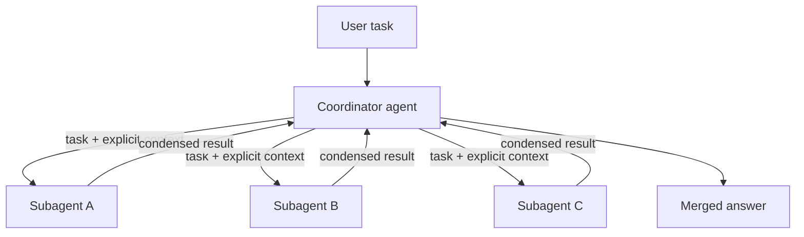

# CCAR-F Domain 1 – Agentic Architecture & Orchestration (27%)

Nov 13, 2026 · Falaque Dani

Domain 1 is 27% of the exam, about 16 of 60 questions. It tests whether you can build a correct agent loop, split work between a coordinator and subagents, and enforce business rules in code instead of prompts.

Study order: read each numbered section, run through its exam traps, then finish with the trap table at the end. Code is Python, using the `anthropic` SDK for the raw Messages API and `claude_agent_sdk` for the Claude Agent SDK. Model IDs use `claude-opus-5-5` (main agent) and `claude-sonnet-5-5` (cheaper subagents).

## 1. The agentic loop

An agent is a loop: call the model, run any tools it asks for, send the results back, and repeat until `stop_reason` says it is finished. The loop is controlled by `stop_reason`, never by reading the model's text.

### stop\_reason values

| Value | Meaning | What your loop does |
| --- | --- | --- |
| `end_turn` | Claude finished its answer | Exit and return the text |
| `tool_use` | Claude wants one or more tools run | Run every `tool_use` block, append results, call again |
| `max_tokens` | Output hit the `max_tokens` cap mid-answer | Raise the cap or split the task; the answer is incomplete |
| `stop_sequence` | A custom stop string you set was produced | Handle per your design (often treat as done) |
| `pause_turn` | A long server-side tool turn (e.g., web search) paused | Append the assistant turn unchanged and call again to resume |
| `refusal` | Safety classifiers declined the request | Do not retry blindly; return a safe message or fall back |

### The message pattern

1. Append the assistant's **full** `response.content` exactly as returned (text and `tool_use` blocks together).
2. Append ONE `user` message containing a `tool_result` block for **every** `tool_use` block, each with the matching `tool_use_id`.
3. If a tool fails, still return a `tool_result`, with `is_error: true` and a clear message. Claude can then retry, pick another tool, or explain the problem.
4. Parallel tool use: one response may contain several `tool_use` blocks. Run them (concurrently if safe) and return all results together in a single `user` message. Splitting them across messages teaches Claude to stop calling tools in parallel.

### Complete Python example

```python
import json
import anthropic

client = anthropic.Anthropic()

TOOLS = [
    {
        "name": "get_customer",
        "description": "Look up a customer by email. Returns customer_id, name "
                       "and identity_verified. Call this before any order action.",
        "input_schema": {
            "type": "object",
            "properties": {"email": {"type": "string"}},
            "required": ["email"],
        },
    },
    {
        "name": "lookup_order",
        "description": "Fetch one order by order_id. Read-only. Returns items, "
                       "total and status.",
        "input_schema": {
            "type": "object",
            "properties": {"order_id": {"type": "string"}},
            "required": ["order_id"],
        },
    },
]

def run_tool(name: str, args: dict) -> str:
    if name == "get_customer":
        return json.dumps(crm.get_customer(args["email"]))      # your code
    if name == "lookup_order":
        return json.dumps(orders.get(args["order_id"]))         # your code
    raise ValueError(f"Unknown tool: {name}")

def run_agent(user_input: str, max_iterations: int = 25) -> str:
    messages = [{"role": "user", "content": user_input}]

    for _ in range(max_iterations):            # safety backstop, not the stop rule
        response = client.messages.create(
            model="claude-opus-5-5",
            max_tokens=16000,
            system="You are a customer support agent for Acme.",
            tools=TOOLS,
            messages=messages,
        )
        # 1. Keep the assistant turn exactly as returned
        messages.append({"role": "assistant", "content": response.content})

        if response.stop_reason == "end_turn":
            return "".join(b.text for b in response.content if b.type == "text")
        if response.stop_reason == "pause_turn":
            continue                            # resend to resume the server tool
        if response.stop_reason == "max_tokens":
            raise RuntimeError("Answer cut off: raise max_tokens or split the task")
        if response.stop_reason == "refusal":
            return "Sorry, I can't help with that request."

        # 2. stop_reason == "tool_use": answer EVERY tool_use block
        tool_results = []
        for block in response.content:
            if block.type != "tool_use":
                continue
            try:
                result = run_tool(block.name, block.input)
                tool_results.append({"type": "tool_result",
                                     "tool_use_id": block.id,
                                     "content": result})
            except Exception as exc:
                tool_results.append({"type": "tool_result",
                                     "tool_use_id": block.id,
                                     "content": f"Error: {exc}",
                                     "is_error": True})
        # 3. All results in ONE user message
        messages.append({"role": "user", "content": tool_results})

    raise RuntimeError("Iteration cap reached: investigate, don't report success")
```

The SDK also offers a Tool Runner (`client.beta.messages.tool_runner`) that runs this loop for you. The exam still expects you to know what the loop does underneath.

### Exam traps

- Deciding the task is done by searching the reply for "DONE" or "task complete" is wrong. Use `stop_reason == "end_turn"`.
- An iteration cap as the main stop condition is wrong. It is only a safety net; hitting it is a failure to investigate.
- Dropping a `tool_result`, mismatching a `tool_use_id`, or sending only the text of the assistant turn breaks the conversation. The API rejects an unanswered `tool_use`.
- Raising an exception out of the loop when a tool fails is weaker than returning `is_error: true`, which lets Claude recover.

## 2. Workflow patterns and when to use each

Start with the simplest design that works. A **workflow** follows code paths you define; an **agent** decides its own steps. Agents cost more and are harder to predict, so use them only when steps can't be known in advance.

| Pattern | How it works | Use when | Example |
| --- | --- | --- | --- |
| Prompt chaining | Fixed sequence; each call's output feeds the next, with code checks (gates) between steps | Task splits into known, ordered steps | Draft outline → check outline → write document → translate |
| Routing | A classifier sends each input to a specialised prompt, tool set or model | Inputs fall into distinct categories | Billing vs technical vs refund questions; easy questions to a smaller model |
| Parallelization: sectioning | Independent subtasks run at the same time; results merged | Subtasks don't depend on each other | Separate security, style and performance reviews of one PR |
| Parallelization: voting | Same task run several times; majority or threshold decides | You need higher confidence on one judgement | Three independent checks for unsafe content |
| Orchestrator–workers | A lead model decides the subtasks at run time and delegates them | Subtasks can't be predicted up front | Research question that needs an unknown number of searches |
| Evaluator–optimizer | One call produces, another critiques against criteria; loop until it passes | Clear quality criteria exist and iteration helps | Translation refined until a reviewer approves |
| Autonomous agent | Model plans and uses tools in a loop with environment feedback | Open-ended problem, unknown number of steps, errors are recoverable | Fix a failing test suite in a codebase |

### Choosing between them

- Known steps → chaining. Known categories → routing. Independent pieces → parallelization.
- Unknown subtasks → orchestrator–workers. Measurable quality bar → evaluator–optimizer.
- Before choosing a full agent, check four things: the task is complex, the value justifies the cost, Claude can do it, and errors can be caught (tests, review, rollback). Any "no" → stay with a workflow.

### Exam traps

- "Build a multi-agent system" for a task with fixed, known steps is over-engineering. Prompt chaining is cheaper, faster and easier to debug.
- Routing and orchestrator–workers both send work to different handlers. Routing picks ONE path from fixed categories; an orchestrator invents subtasks at run time.
- Voting uses the SAME task several times; sectioning splits DIFFERENT subtasks. Don't mix them up.

## 3. Coordinator–subagent design (hub and spoke)

A coordinator (lead) agent breaks a task into pieces, sends each piece to a subagent, and merges what comes back. Subagents never talk to each other; everything goes through the coordinator.



The coordinator is the only agent that sees the whole picture; each subagent sees only what the coordinator hands it.

### Context isolation

- Each subagent starts with a **fresh context**. It does not see the coordinator's conversation, the user's original message, or other subagents' results.
- Everything a subagent needs must be passed **explicitly** in its task prompt: the goal, relevant facts, constraints, what "done" looks like, and the output format.
- Subagents return a **condensed** result (e.g., a JSON summary with sources), not their full transcript. This keeps the coordinator's context small and focused.

**Example of explicit context passing.** Weak task: "Research the competitor we discussed." The subagent has no idea who that is. Strong task:

```text
Goal: Find Q3 2026 pricing changes for Contoso Cloud's storage tiers.
Context: The user is comparing Contoso with our Standard tier ($0.020/GB).
Constraints: Use only official Contoso pages or press releases from 2026.
Return JSON: {"findings": [{"claim": str, "source_url": str, "date": str}],
              "gaps": [str]}
```

### Dynamic selection and iterative refinement

- The coordinator chooses subagents based on the request. A simple factual question may need one search subagent; a broad report may need five in parallel. Calling every subagent on every request wastes tokens and time.
- After results return, the coordinator checks for gaps or conflicts and sends targeted follow-up tasks ("Source for claim 3 is missing; find a primary source").
- Give the coordinator a clear way to decide when it has enough (coverage criteria), not an open-ended "keep researching".

### Benefits and costs

| Benefit | Cost |
| --- | --- |
| Parallel work: faster for broad tasks | Many more tokens in total (each subagent has its own context) |
| Clean, focused context per subagent | Coordination logic and more failure points |
| Specialised prompts and least-privilege tool sets | Information can be lost at each handoff |

Use multi-agent for broad, parallelizable work (research across many sources, reviewing many files). Use a single agent for tightly coupled, sequential tasks where every step needs the full history.

### Exam traps

- Assuming a subagent "knows" the earlier conversation. It doesn't; the fix for off-target subagent output is usually better context in the task prompt.
- Letting subagents call each other or share a scratch context. The pattern routes everything through the coordinator.
- Choosing multi-agent "for quality" on a small sequential task. It multiplies cost without benefit.

## 4. Spawning subagents in the Claude Agent SDK

The Claude Agent SDK (`claude_agent_sdk`) is Claude Code packaged as a library: built-in tools, the agent loop, hooks, sessions and subagents. You define subagents in `ClaudeAgentOptions(agents=...)`, and the main agent delegates to them through the **Agent** tool (named **Task** before Claude Code v2.1.63; older material and exam wording may still say Task).

### Python example: coordinator with two subagents

```python
import asyncio
from claude_agent_sdk import query, ClaudeAgentOptions, AgentDefinition, ResultMessage

options = ClaudeAgentOptions(
    model="claude-opus-5-5",
    # "Agent" lets the coordinator delegate to the subagents below
    allowed_tools=["Read", "Grep", "Glob", "Agent"],
    agents={
        "security-reviewer": AgentDefinition(
            description="Security review specialist. Use for auth, input "
                        "validation and secrets-handling reviews.",
            prompt="You review code for security flaws. Report each issue as "
                   "file, line, severity and suggested fix.",
            tools=["Read", "Grep", "Glob"],   # read-only: least privilege
            model="sonnet",                   # cheaper model for the worker
        ),
        "test-runner": AgentDefinition(
            description="Runs the test suite and summarises failures. "
                        "Use after code changes.",
            prompt="You run tests and report each failing test with its likely cause.",
            tools=["Bash", "Read", "Grep"],
        ),
    },
)

async def main():
    async for message in query(
        prompt="Review the payments module for security issues and run its "
               "tests. Do both at the same time.",
        options=options,
    ):
        if isinstance(message, ResultMessage) and message.subtype == "success":
            print(message.result)

asyncio.run(main())
```

### AgentDefinition fields to know

| Field | Required | Purpose |
| --- | --- | --- |
| `description` | Yes | When to use this subagent. Claude reads it to decide whether to delegate, so write it as "Use for…" |
| `prompt` | Yes | The subagent's system prompt: role, method, output format |
| `tools` | No | Allowed tools. Omit it and the subagent inherits the available tools; list them to restrict it |
| `model` | No | e.g. `"sonnet"` for a cheaper worker |
| `disallowedTools`, `maxTurns`, `mcpServers`, `skills` | No | Extra limits and capabilities. Note the camelCase names: snake\_case raises a `TypeError` |

In Claude Code (not the SDK), the same idea lives in `.claude/agents/<name>.md` files with `name`, `description`, `tools` and `model` in the frontmatter.

### Parallel subagents

- The coordinator runs subagents in parallel by issuing **several Agent tool calls in a single response**. Asking it to do things "at the same time" or "in parallel" encourages this.
- Each parallel subagent has its own context, so they can't build on each other's results. If B needs A's output, run them in sequence.

### Exam traps

- The coordinator can't delegate if it can't use the Agent (Task) tool. A subagent that is "never called" often means a missing tool permission or a vague `description`.
- Giving every subagent every tool. Restrict `tools` per role; a reviewer doesn't need `Bash` or `Write`.
- Expecting a subagent to see files or facts discussed earlier with the coordinator. Pass them in the delegation prompt.

## 5. Enforcing multi-step workflows and escalation handoffs

If a rule must hold **every** time, enforce it in code. A system-prompt instruction such as "always verify identity before refunds" works most of the time, but a model is probabilistic, so "most of the time" is not compliance.

### Prompt guidance vs programmatic gate

|  | Prompt instruction | Programmatic gate |
| --- | --- | --- |
| How | "Always call get\_customer before process\_refund" in the system prompt | Code refuses `process_refund` until verification is recorded |
| Reliability | High but not 100% | 100%: the call cannot succeed out of order |
| Use for | Style, tone, soft preferences | Money, security, compliance, data deletion |

### Python example: identity gate before refund

This plugs into the `run_agent` loop from section 1; an exception becomes a `tool_result` with `is_error: true`, so Claude learns what to do next.

```python
class PolicyError(Exception):
    pass

class SupportSession:
    REFUND_LIMIT = 500.00

    def __init__(self):
        self.verified_customer_id = None   # set only by code, never by the model

    def run_tool(self, name: str, args: dict) -> str:
        if name == "get_customer":
            customer = crm.get_customer(args["email"])
            if customer["identity_verified"]:
                self.verified_customer_id = customer["customer_id"]
            return json.dumps(customer)

        if name == "process_refund":
            if self.verified_customer_id is None:
                raise PolicyError("Identity not verified. Call get_customer "
                                  "and confirm identity before any refund.")
            order = orders.get(args["order_id"])
            if order["customer_id"] != self.verified_customer_id:
                raise PolicyError("Order does not belong to the verified customer.")
            if args["amount"] > self.REFUND_LIMIT:
                raise PolicyError("Amount exceeds the agent refund limit. "
                                  "Use escalate_to_human.")
            return json.dumps(billing.refund(args["order_id"], args["amount"]))

        raise ValueError(f"Unknown tool: {name}")
```

In the Agent SDK the same gate is usually a `PreToolUse` hook (section 6).

### Requests with several concerns

A customer may write: "Refund order 1182, and also update my shipping address." Weak agents solve the first item and stop.

- Have the agent list every concern first, then work through each one.
- Before finishing, check that every concern is resolved or explicitly escalated (a code check on the final turn, or a `Stop` hook).
- Independent concerns can be handled in parallel; dependent ones in order.

### Structured escalation handoffs

The human who picks up an escalation has **not** read the transcript. Give them a structured summary through a dedicated tool:

```python
ESCALATE_TOOL = {
    "name": "escalate_to_human",
    "description": "Hand the case to a human agent. Use when the customer asks "
                   "for a human, policy doesn't cover the case, or the action "
                   "exceeds your authority.",
    "input_schema": {
        "type": "object",
        "properties": {
            "customer_id": {"type": "string"},
            "reason": {"type": "string",
                       "enum": ["customer_request", "policy_gap",
                                "over_authority", "repeated_failure"]},
            "issue_summary": {"type": "string"},
            "actions_taken": {"type": "array", "items": {"type": "string"}},
            "current_state": {"type": "string"},
            "recommended_next_step": {"type": "string"},
        },
        "required": ["customer_id", "reason", "issue_summary",
                     "actions_taken", "recommended_next_step"],
    },
}
```

### Exam traps

- "Strengthen the system prompt with CAPITAL LETTERS" to stop refunds before verification. The correct fix is a programmatic gate or hook.
- Letting the model set its own `verified` flag (e.g., a tool argument `verified=true`). Verification state must come from your code.
- An escalation that just says "customer needs help, see chat". Handoffs need customer ID, issue, actions taken, state and a recommended next step.

## 6. Agent SDK hooks

Hooks are your own functions that run at fixed points in the agent loop. They are deterministic: they run every time, whatever the model decides. That makes them the standard answer for compliance rules and output clean-up.

### Hook events

| Event | Fires | Typical use |
| --- | --- | --- |
| `PreToolUse` | Before a tool runs | Allow, deny or ask; block policy-violating calls; validate inputs |
| `PostToolUse` | After a tool returns, before Claude sees the result | Normalize, trim or replace output; add context; audit logging |
| `UserPromptSubmit` | When a prompt is submitted | Add context or validate the prompt |
| `Stop` / `SubagentStop` | When the agent or a subagent finishes | Final checks (all concerns handled?) |
| `PreCompact`, `SessionStart`, `Notification` | Around compaction, startup, alerts | Housekeeping |

### PreToolUse: deny refunds above a limit

```python
from claude_agent_sdk import query, ClaudeAgentOptions, HookMatcher

REFUND_LIMIT = 500

async def block_large_refunds(input_data, tool_use_id, context):
    amount = input_data["tool_input"].get("amount", 0)
    if amount > REFUND_LIMIT:
        return {
            "hookSpecificOutput": {
                "hookEventName": input_data["hook_event_name"],
                "permissionDecision": "deny",
                "permissionDecisionReason": f"Refunds over ${REFUND_LIMIT} need a "
                                            "human. Use escalate_to_human.",
            }
        }
    return {}   # empty dict = no objection, the call proceeds
```

- Signature: `async def hook(input_data, tool_use_id, context)`. `input_data` is a dict with `tool_name`, `tool_input` and `hook_event_name`.
- `permissionDecision` can be `"allow"`, `"deny"`, `"ask"` or `"defer"`. If hooks disagree, **deny wins**.
- The `permissionDecisionReason` goes back to Claude, so make it tell Claude what to do instead.
- `PreToolUse` hooks run even for tools pre-approved in `allowed_tools`.

### PostToolUse: normalize tool output

Raw tool output is often noisy: 40 fields, Unix timestamps, amounts in cents. Clean it before Claude reads it.

```python
from datetime import datetime, timezone

async def normalize_order(input_data, tool_use_id, context):
    order = input_data["tool_response"]          # shape depends on your tool
    slim = {
        "order_id": order["id"],
        "status": order["status"],
        "total_usd": round(order["total_cents"] / 100, 2),
        "placed_on": datetime.fromtimestamp(order["created_ts"], tz=timezone.utc)
                             .date().isoformat(),
    }
    return {
        "hookSpecificOutput": {
            "hookEventName": "PostToolUse",
            "updatedToolOutput": slim,    # replaces what Claude sees
        }
    }
```

- `updatedToolOutput` replaces the result Claude sees (built-in and MCP tools). `additionalContext` appends a note instead.
- The tool has **already run**. PostToolUse can clean up or log, but it cannot undo the action; prevention belongs in PreToolUse.

### Registering the hooks

```python
options = ClaudeAgentOptions(
    mcp_servers={"billing": billing_server},           # your MCP server
    allowed_tools=["mcp__billing__lookup_order", "mcp__billing__process_refund"],
    hooks={
        "PreToolUse": [HookMatcher(matcher="mcp__billing__process_refund",
                                   hooks=[block_large_refunds])],
        "PostToolUse": [HookMatcher(matcher="mcp__billing__lookup_order",
                                    hooks=[normalize_order])],
    },
)
```

`matcher` is a tool-name pattern (e.g., `"Write|Edit"`); omit it to match every tool.

### Exam traps

- Using PostToolUse to block a dangerous action. Too late: the tool already ran. Use PreToolUse.
- Relying on a system-prompt rule when the scenario says the policy must never be violated. A hook is deterministic; a prompt is not.
- Asking Claude to "ignore irrelevant fields" in a huge tool response. Trimming in a PostToolUse hook saves context and is reliable.

## 7. Task decomposition

Big tasks go better when split into smaller steps. The question is whether the steps are fixed in advance or chosen as the work unfolds.

|  | Fixed decomposition (prompt chaining) | Adaptive decomposition |
| --- | --- | --- |
| Plan | Written in code before the run | Built and revised by the agent as findings arrive |
| Predictability | High; easy to test and debug | Lower; flexible |
| Best for | Repeatable processes | Open-ended investigation |
| Example | Code review: one pass per file, then one cross-file integration pass | "Find why checkout latency doubled last week": each finding decides the next query |

**Example: large PR review.** One pass over 40 changed files dilutes attention and misses issues. A fixed chain works better: (1) review each file on its own for local bugs, (2) run a separate cross-file pass that looks only at how the pieces interact, (3) merge and de-duplicate findings.

### Exam traps

- Using an open-ended agent for a repeatable, well-defined process. Fixed chaining is cheaper and more consistent.
- Forcing a rigid plan on an investigation whose next step depends on what is found. That calls for adaptive decomposition.

## 8. Session state: continue, resume, fork

An agent session is the saved conversation history. Long tasks often span several runs, so you need to pick the right way to restart.

| Option | CLI | Agent SDK (`ClaudeAgentOptions`) | Use when |
| --- | --- | --- | --- |
| Continue | `claude --continue` | `continue_conversation=True` | Pick up the most recent session in this directory |
| Resume | `claude --resume <session-id>` | `resume=session_id` | Return to a specific earlier session |
| Fork | `--fork-session` with resume | `resume=session_id, fork_session=True` | Try an alternative from the same starting point without changing the original |
| Fresh start | new session | no resume options | Earlier context is stale or misleading |

Getting the session ID in Python:

```python
from claude_agent_sdk import query, ClaudeAgentOptions, ResultMessage

session_id = None
async for message in query(prompt="Analyze the auth module",
                           options=ClaudeAgentOptions(allowed_tools=["Read", "Grep"])):
    if isinstance(message, ResultMessage):
        session_id = message.session_id

# Later: branch off to try a different approach, original stays untouched
async for message in query(prompt="Now try the OAuth approach instead",
                           options=ClaudeAgentOptions(resume=session_id,
                                                      fork_session=True)):
    ...
```

### Resume or start fresh?

- **Resume** when the earlier context is still true: same files, same data, the work just paused.
- **Start fresh with a summary** when earlier tool results are stale (files edited since, data refreshed). A resumed session trusts what it read before and may act on outdated facts.
- Middle option: resume, but tell the session exactly what changed ("`auth.py` and `session.py` were edited since your last read; re-read them before continuing").
- Forking copies the conversation only, not the state of files on disk.

### Exam traps

- Resuming a long session after the codebase changed and expecting correct answers. Stale tool results lead to confident wrong actions.
- Using resume to compare two approaches. Resuming twice changes the same session; `fork_session` keeps the branches separate.
- Assuming a fork also restores files. It only copies history.

## Exam traps: Domain 1 summary

Most wrong options in this domain fall into one of the patterns below. When two answers look plausible, prefer the one that is deterministic, explicit and simplest.

| Tempting wrong answer | Correct answer |
| --- | --- |
| Stop the loop when the reply contains "DONE" | Stop when `stop_reason == "end_turn"` |
| Use a max-iteration count as the stop condition | `stop_reason` decides; the cap is only a safety backstop |
| Send tool results in separate user messages | All `tool_result` blocks in ONE user message, matched by `tool_use_id` |
| Throw an exception when a tool fails | Return a `tool_result` with `is_error: true` and a useful message |
| Ignore `max_tokens` and use the partial answer | Treat it as incomplete: raise the limit or split the task |
| Build a multi-agent system for fixed, known steps | Prompt chaining (a workflow) |
| Subagent will remember the earlier conversation | Pass all needed context explicitly; subagents are isolated |
| Let subagents message each other directly | Route everything through the coordinator |
| Run every subagent on every request | Coordinator selects subagents based on the request |
| Give all subagents all tools | Restrict `tools` per role (least privilege) |
| Coordinator can't delegate? Rewrite its prompt | Check that the Agent (Task) tool is allowed and descriptions are clear |
| Enforce refund policy with a stronger system prompt | Programmatic gate or `PreToolUse` hook |
| Block a dangerous action in `PostToolUse` | `PreToolUse`; PostToolUse runs after the tool already ran |
| Escalate with "see transcript" | Structured handoff: ID, issue, actions taken, state, next step |
| Resume a session after files changed | Start fresh with a summary, or tell the session what changed |
| Resume twice to compare two approaches | `fork_session=True` |

## Key facts to memorize

- `stop_reason` values: `end_turn`, `tool_use`, `max_tokens`, `stop_sequence`, `pause_turn`, `refusal`.
- Message pattern: assistant `content` unchanged → user message of `tool_result` blocks, one per `tool_use_id`.
- Six patterns: prompt chaining, routing, parallelization (sectioning / voting), orchestrator–workers, evaluator–optimizer, autonomous agent.
- Hub and spoke: coordinator decomposes, delegates, merges; subagents have isolated context and return condensed results.
- Agent SDK: `ClaudeAgentOptions(agents={name: AgentDefinition(description, prompt, tools, model)})`; delegation via the Agent (formerly Task) tool; parallel = several Agent calls in one response.
- Hooks: `PreToolUse` prevents (allow / deny / ask / defer; deny wins); `PostToolUse` cleans up (`updatedToolOutput`, `additionalContext`).
- Sessions: `--continue` / `continue_conversation=True`, `--resume <id>` / `resume=`, `fork_session=True`; `ResultMessage.session_id`.
- Rule of thumb: must-always rules go in code; preferences go in prompts.
