# CCAR-F Domain 2 – Claude Code Configuration & Workflows (20%)

Nov 13, 2026 · Falaque Dani

## What this domain tests

Domain 2 is 20% of the exam, about 12 of 60 questions. It asks two kinds of question: **where does this configuration belong** (and who will it affect), and **which Claude Code workflow fits this task**.

Most questions come from the *Code Generation with Claude Code*, *Developer Productivity* and *Claude Code for CI/CD* scenarios. A typical stem: "A team rule is ignored by some developers. What is the most likely cause?" The answer usually turns on file location and scope.

| Topic | What you must be able to do |
| --- | --- |
| CLAUDE.md and rules | Put each instruction at the right level so the right people get it |
| Commands, skills, subagents | Pick the right extension point for a repeated workflow |
| settings.json | Know precedence, permission rules and hooks |
| Plan mode, refinement | Choose plan vs direct execution; steer Claude well |
| CI/CD | Run Claude headless with structured output and safe limits |

**How to study it:** for every file in this doc, memorize three things: its path, who it applies to (you, the team, everyone on the machine), and when it is loaded (always, on demand, or only for matching files).

## 2.1 CLAUDE.md: persistent project memory

CLAUDE.md is a markdown file of standing instructions that Claude Code loads into context automatically at the start of every session. It is how you teach Claude your build commands, conventions and architecture once, instead of repeating them in every prompt.

### The levels

| Level | Path | Applies to | Shared via git? |
| --- | --- | --- | --- |
| Managed policy | OS-wide path set by IT (e.g. `/etc/claude-code/CLAUDE.md` on Linux, `/Library/Application Support/ClaudeCode/CLAUDE.md` on macOS) | Every user on the machine | No, deployed by admins |
| User | `~/.claude/CLAUDE.md` | You, in every project | No |
| Project | `./CLAUDE.md` or `./.claude/CLAUDE.md` | Everyone working in the repo | Yes, commit it |
| Local project | `./CLAUDE.local.md` | You, in this repo only | No, gitignored |
| Subdirectory | `path/to/dir/CLAUDE.md` | Anyone, when Claude works in that folder | Yes |

### How loading works

- At startup Claude Code walks **up** from the current working directory to the filesystem root and loads every CLAUDE.md it finds. Starting in `repo/services/api` loads `repo/CLAUDE.md` too.
- CLAUDE.md files in folders **below** the working directory are loaded **on demand**, when Claude reads or edits files in that folder.
- All levels are combined, not replaced. When instructions conflict, the more specific one (closer to the work) generally wins, and managed policy cannot be overridden.

### Imports with @

A CLAUDE.md can pull in other files with `@path`. Relative, absolute and `~` paths work. Imports can nest up to 5 levels deep. An `@` inside a code span or code block is not treated as an import.

```markdown
See @README.md for the project overview and @package.json for npm scripts.

# Team standards
@docs/coding-standards.md
@docs/git-workflow.md

# My personal preferences (not committed)
@~/.claude/my-project-prefs.md
```

Imports keep the main file short and let several tools share one source of truth (for example, a standards doc that humans also read).

### Commands that manage memory

- `/init` scans the codebase and writes a starter project CLAUDE.md (build commands, structure, conventions). Review and trim it.
- `/memory` lists the memory files loaded in this session and opens one in your editor.

### What belongs in CLAUDE.md

Put in it facts that apply to almost every task: build, test and lint commands; code style rules that differ from defaults; architecture notes and where things live; repo etiquette (branch names, commit format); warnings ("never edit generated files in `gen/`").

Keep out of it: long step-by-step procedures used occasionally (make a skill), rules for one file type only (make a path rule), secrets, and anything Claude can read from the code itself. Every line costs context in every session.

### Example project CLAUDE.md

```markdown
# Payments Service

## Commands
- Install: `uv sync`
- Test: `uv run pytest -q`
- Lint and format: `uv run ruff check --fix && uv run ruff format`

## Architecture
- `app/api/` FastAPI routers, one file per resource
- `app/domain/` business logic, no framework imports
- `app/adapters/` database and third-party clients

## Conventions
- Type hints on every public function; mypy must pass
- Money is `Decimal`, never `float`
- New endpoints need a test in `tests/api/`

## Do not
- Edit files in `app/generated/` (rebuilt by `make codegen`)
- Commit directly to `main`
```

**Exam traps**

- A team convention in `~/.claude/CLAUDE.md` works only for the developer who wrote it. Team rules go in the project CLAUDE.md, committed to git. "Works for Alice, not for Bob" almost always means user-level vs project-level.
- A rule in `frontend/CLAUDE.md` is not loaded when Claude starts at the repo root and never touches `frontend/` files. Use a root CLAUDE.md or a path rule when it must always apply.
- Bloating CLAUDE.md with rarely used procedures wastes context in every session; long procedures belong in skills.

### Configuration map

```mermaid
flowchart TB
  subgraph MEM["Memory: CLAUDE.md (all levels load together)"]
    M1[Managed policy CLAUDE.md] --- M2["Project ./CLAUDE.md (committed)"]
    M2 --- M3["User ~/.claude/CLAUDE.md"]
    M3 --- M4["Subdirectory CLAUDE.md (loaded when Claude works there)"]
    M4 --- M5[".claude/rules/*.md with paths: globs"]
  end
  subgraph SET["Settings: settings.json (higher rank wins)"]
    S1[Rank 1: Managed policy settings] --> S2[Rank 2: Command-line arguments]
    S2 --> S3[Rank 3: .claude/settings.local.json]
    S3 --> S4[Rank 4: .claude/settings.json]
    S4 --> S5["Rank 5: ~/.claude/settings.json"]
  end
```



CLAUDE.md files from every level are loaded together; settings files are ranked, and a higher rank overrides a lower one.

## 2.2 Path-specific rules (.claude/rules/)

Rules split CLAUDE.md into focused files, and a `paths:` glob makes a rule load only when Claude works on matching files.

- Every `.md` file in `.claude/rules/` (subfolders included) is project memory, loaded like CLAUDE.md.
- A rule **without** `paths:` frontmatter loads in every session.
- A rule **with** `paths:` loads only when Claude reads or edits a file matching one of the globs. This saves context and keeps irrelevant rules out of the way.
- Personal rules can live in `~/.claude/rules/` and apply across all your projects.

### Example: a rule for all test files

`.claude/rules/testing.md`

```markdown
---
paths:
  - "**/test_*.py"
  - "**/*_test.py"
  - "tests/**/*.py"
---

# Testing rules
- Use pytest fixtures, not setUp/tearDown classes
- One behaviour per test; name tests `test_<unit>_<behaviour>`
- Mock network calls with `respx`; never hit real APIs
- Use `freezegun` for anything time-dependent
```

### Rules vs subdirectory CLAUDE.md

| Need | Best choice | Why |
| --- | --- | --- |
| Conventions for one folder (`billing/`) | `billing/CLAUDE.md` | Lives next to the code it describes |
| Conventions for a file type spread across the repo (all tests, all SQL migrations, all `*.tsx`) | `.claude/rules/` with `paths:` | One glob covers every folder |
| A topic that applies everywhere but makes CLAUDE.md too long | `.claude/rules/<topic>.md` without `paths:` | Modular, still always loaded |

**Exam traps**

- Copying the same test conventions into ten subdirectory CLAUDE.md files is the wrong answer when one rule with a `**/test_*.py` glob would do.
- A path rule does not load until a matching file is touched. If the question needs the rule before any file is opened (e.g. during planning), it must be always-loaded.
- Rules are project memory: commit `.claude/rules/` for team rules, just like CLAUDE.md.

## 2.3 Custom slash commands

A custom slash command is a saved prompt in a markdown file that a user runs by typing `/name`. Use one when a team repeats the same instruction often (review a PR, write a changelog, triage an issue).

| Scope | Location | Invoked as | Who gets it |
| --- | --- | --- | --- |
| Project | `.claude/commands/<name>.md` | `/name` | Everyone who clones the repo |
| Personal | `~/.claude/commands/<name>.md` | `/name` | Only you, in every project |

Subfolders organize commands (for example `.claude/commands/frontend/component.md`). Newer Claude Code versions treat commands as a simple form of skill, so files in `.claude/commands/` keep working.

### Arguments and frontmatter

- `$ARGUMENTS` inserts everything typed after the command name.
- `$1`, `$2`, … insert individual positional arguments.
- `@path/to/file` in the body pulls a file's contents into the prompt.
- Optional frontmatter: `description` (shown in the `/` menu), `argument-hint` (e.g. `[issue-number] [priority]`), `allowed-tools` (tools the command may use without asking), `model`.

### Example: fix a GitHub issue

`.claude/commands/fix-issue.md`

```markdown
---
description: Investigate and fix a GitHub issue end to end
argument-hint: [issue-number] [priority]
allowed-tools: Bash(gh issue view:*), Read, Grep, Glob, Edit
---

Fix GitHub issue #$1 (priority: $2).

1. Run `gh issue view $1` and read the report.
2. Find the relevant code with Grep and Glob.
3. Write a failing test that reproduces the bug.
4. Fix the code until the test passes; run `uv run pytest -q`.
5. Summarize the root cause and the change.
```

Running `/fix-issue 482 high` replaces `$1` with `482` and `$2` with `high`.

**Exam traps**

- A command the whole team should use must be in `.claude/commands/` (committed), not `~/.claude/commands/`.
- A command only runs when a user types it. If Claude should apply the workflow automatically when it fits the task, the answer is a skill, not a command.
- `$ARGUMENTS` is the full string; `$1`/`$2` split it into positions. Use positional arguments when the prompt needs each value in a different place.

## 2.4 Skills

A skill is a folder of instructions (and optional scripts or reference files) that Claude loads only when the task needs it. Claude can invoke a skill on its own when its description matches the request, or a user can call it as `/skill-name`.

### Where skills live

- Project: `.claude/skills/<skill-name>/SKILL.md` (commit it for the team)
- Personal: `~/.claude/skills/<skill-name>/SKILL.md`
- Plugins can also ship skills.

### Progressive disclosure

1. At session start, only each skill's `name` and `description` are loaded (a few dozen tokens each).
2. When a task matches a description, Claude loads the full SKILL.md body.
3. Supporting files in the folder (templates, scripts, reference docs) are read only if the instructions call for them.

This is why many skills cost almost nothing until used, unlike CLAUDE.md, which is paid for in every session.

### Frontmatter fields to know

| Field | Purpose |
| --- | --- |
| `name` | Identifier; also the `/name` users can type |
| `description` | What the skill does AND when to use it. Claude decides on automatic use from this text, so it matters most |
| `allowed-tools` | Tools the skill may use without asking while it runs (e.g. `Read, Grep, Bash(git log:*)`) |
| `context: fork` | Run the skill in an isolated subagent context; only its result returns to the main conversation |
| `argument-hint` | Hint shown for arguments, e.g. `[file-path]` |
| `disable-model-invocation` | `true` = only a user can trigger it (good for actions with side effects, like deploys) |

### Example SKILL.md

`.claude/skills/db-migration/SKILL.md`

```markdown
---
name: db-migration
description: Create and verify an Alembic database migration. Use when the user
  asks to add, change or remove a database table, column or index.
argument-hint: [short-change-description]
allowed-tools: Read, Edit, Write, Bash(uv run alembic:*), Bash(uv run pytest:*)
context: fork
---

# Creating a migration
1. Update the SQLAlchemy model in `app/adapters/db/models.py`.
2. Run `uv run alembic revision --autogenerate -m "$ARGUMENTS"`.
3. Open the new file and check it against `checklist.md` in this folder.
4. Run `uv run alembic upgrade head` then `uv run alembic downgrade -1`
   to prove the migration reverses cleanly.
5. Run the test suite and report the result.
```

The folder could also contain `checklist.md` and a `templates/` directory; Claude reads them only at step 3.

### Skill vs CLAUDE.md vs command vs subagent

| Use | When |
| --- | --- |
| CLAUDE.md / rules | Short facts needed in nearly every task (always loaded) |
| Slash command | A saved prompt a person triggers by hand |
| Skill | A reusable procedure or expertise, loaded on demand, possibly auto-triggered, can bundle files |
| Subagent | A separate worker with its own context, prompt and tool set (see 2.5) |

**Exam traps**

- A long procedure used once a week does not belong in CLAUDE.md; it belongs in a skill (progressive disclosure saves context).
- If Claude never uses a skill automatically, fix the `description` first: it must say when to use it, in words that match how users ask.
- `context: fork` keeps a noisy skill (large searches, long logs) from flooding the main conversation. If the question complains about the main context filling up during a skill, this is the fix.

## 2.5 Subagents (.claude/agents/)

A subagent is a specialized assistant with its own system prompt, its own tool list and its own context window. Claude delegates a task to it and gets back only a summary, which keeps the main conversation clean.

- Project subagents: `.claude/agents/<name>.md` (shared with the team). Personal: `~/.claude/agents/<name>.md`. Project wins on a name clash.
- Create and manage them with the `/agents` command, or write the file by hand.
- Claude delegates automatically when a task matches the `description`, or you can ask explicitly ("use the code-reviewer subagent").
- Built-in subagents include **Explore** (fast, read-only codebase search), **Plan** (research during plan mode) and a general-purpose agent.
- A subagent cannot start its own subagents.

### Frontmatter fields

| Field | Purpose |
| --- | --- |
| `name` | Unique identifier |
| `description` | When to use it; drives automatic delegation ("Use proactively after code changes") |
| `tools` | Comma-separated allowed tools. Omit to inherit all tools, including MCP tools |
| `model` | `sonnet`, `opus`, `haiku` or `inherit` |

The markdown body becomes the subagent's system prompt.

### Example: a read-only security reviewer

`.claude/agents/security-reviewer.md`

```markdown
---
name: security-reviewer
description: Reviews changed Python code for security issues. Use proactively
  after any change to authentication, payments or input handling.
tools: Read, Grep, Glob, Bash(git diff:*)
model: sonnet
---

You are a senior application security reviewer.

Run `git diff` to see what changed, then check for:
- SQL built from string formatting with user input
- Secrets or tokens in code or logs
- Missing authorization checks on new endpoints
- Unsafe deserialization (pickle, yaml.load)

Report each finding as: file:line, severity (high/medium/low), why, fix.
Do not edit files.
```

Note the tool list: no Edit or Write. Least privilege makes the reviewer safe to run automatically.

**Exam traps**

- Subagents do not see the main conversation. Anything they need must be in their prompt or the task Claude passes them.
- Omitting `tools` gives the subagent every tool. A reviewer or researcher should get a restricted, read-only list.
- Use a subagent (not a skill) when you need a separate context window and a different tool set; use a skill when you only need extra instructions in the current context (or `context: fork` for isolation).

## 2.6 settings.json: permissions and hooks

CLAUDE.md tells Claude what to do; settings.json controls what Claude Code is allowed to do and what runs automatically. Settings are enforced by the harness, not by the model.

### Levels and precedence (highest first)

| Rank | File | Scope |
| --- | --- | --- |
| 1 | Managed policy (`managed-settings.json`, deployed by IT) | Whole organization; cannot be overridden |
| 2 | Command-line flags (`--allowedTools`, `--permission-mode` …) | This run only |
| 3 | `.claude/settings.local.json` | You, this project (gitignored) |
| 4 | `.claude/settings.json` | Team, this project (committed) |
| 5 | `~/.claude/settings.json` | You, all projects |

### Permissions

Permission rules decide which tool calls run without asking. They are checked in the order **deny → ask → allow**, so a deny rule always wins.

```json
{
  "permissions": {
    "allow": [
      "Bash(uv run pytest:*)",
      "Bash(git diff:*)",
      "Edit(src/**)"
    ],
    "ask": [
      "Bash(git push:*)"
    ],
    "deny": [
      "Read(./.env)",
      "Read(./secrets/**)",
      "Bash(curl:*)"
    ]
  }
}
```

- `Bash(uv run pytest:*)` matches any command starting with `uv run pytest`.
- `WebFetch(domain:docs.python.org)` limits fetches to one domain.
- MCP tools are named `mcp__<server>__<tool>`.

### Hooks

Hooks are shell commands that run on lifecycle events: `PreToolUse`, `PostToolUse`, `UserPromptSubmit`, `Stop`, `SubagentStop`, `SessionStart`, `PreCompact`, `Notification` and others. They receive event details as JSON on stdin. A `PreToolUse` hook that exits with code 2 **blocks** the tool call, and its stderr is shown to Claude so it can adjust.

Example: auto-format every Python file Claude edits.

`.claude/settings.json`

```json
{
  "hooks": {
    "PostToolUse": [
      {
        "matcher": "Edit|Write",
        "hooks": [
          { "type": "command", "command": "python3 .claude/hooks/format_py.py" }
        ]
      }
    ]
  }
}
```

`.claude/hooks/format_py.py`

```python
import json
import subprocess
import sys

event = json.load(sys.stdin)                      # hook input arrives on stdin
path = event.get("tool_input", {}).get("file_path", "")

if path.endswith(".py"):
    subprocess.run(["ruff", "format", path], check=False)

sys.exit(0)                                       # 0 = success, carry on
```

A blocking example: a `PreToolUse` hook with matcher `Edit|Write` that exits 2 when `file_path` is under `app/generated/` stops Claude from ever editing generated code, every time.

**Exam traps**

- "Always format after editing" or "never touch production config" must be enforced: a hook or a deny rule beats a CLAUDE.md sentence, which Claude may occasionally miss.
- Deny beats allow. If a command is in both lists, it is denied.
- Personal permission tweaks go in `settings.local.json`; putting them in `.claude/settings.json` changes them for the whole team.

## 2.7 Plan mode vs direct execution

Plan mode makes Claude research read-only and propose a plan before it changes anything; direct execution lets it edit straight away. The exam asks you to match the mode to the task's size and uncertainty.

- Enter plan mode with **Shift+Tab** (cycles normal → auto-accept edits → plan) or start with `claude --permission-mode plan`.
- In plan mode Claude can read, search and ask questions, but cannot edit files or run changing commands. You approve the plan, then it executes.

| Use plan mode when | Use direct execution when |
| --- | --- |
| The change touches many files or modules | The change is small and well defined |
| Requirements are unclear or there are several valid designs | You already know exactly what to change |
| The code is unfamiliar or high-risk (auth, payments, migrations) | Typo, rename, one test, a log line |
| You want to review the approach before code is written | Speed matters more than review |

### Example

> **Task:** "Move session storage from in-memory to Redis across the service."
>
> Plan mode first: Claude finds every use of the session store, proposes an interface, a Redis adapter, config changes and a test plan. You adjust ("keep the in-memory store for tests"), then approve.
>
> **Task:** "Rename `get_usr` to `get_user` in `users.py`." Direct execution.

### The Explore subagent

Explore is a built-in, read-only subagent tuned for fast codebase search. Claude hands it questions like "where is rate limiting implemented?"; it searches with Glob, Grep and Read in its own context and returns a short summary.

Why it matters: exploring a large codebase can pour thousands of lines of search output into context. Delegating to Explore keeps the main conversation focused on the decision, not the raw search results.

**Exam traps**

- Jumping straight to edits on a large, ambiguous refactor is the wrong answer; plan mode first.
- Plan mode for a one-line fix is over-engineering. The exam rewards matching effort to risk.
- If the main context fills with search output during investigation, the fix is delegating exploration to a subagent (Explore), not a bigger context window.

## 2.8 Iterative refinement techniques

Claude Code works best when it has a clear target it can check itself against. These techniques give it one.

### 1. Concrete input/output examples

Two or three examples beat a paragraph of description.

```text
Write normalize_phone(raw: str) -> str. Examples:
  "(415) 555-0132"   -> "+14155550132"
  "415.555.0132"     -> "+14155550132"
  "+44 20 7946 0958" -> "+442079460958"
Raise ValueError for anything with fewer than 10 digits.
```

### 2. Test-driven iteration

Write (or have Claude write) the tests first, confirm they fail, then let Claude change the code until they pass. The test suite is an objective "done" signal.

```python
# tests/test_phone.py
import pytest
from app.phone import normalize_phone

@pytest.mark.parametrize("raw, expected", [
    ("(415) 555-0132", "+14155550132"),
    ("415.555.0132", "+14155550132"),
    ("+44 20 7946 0958", "+442079460958"),
])
def test_normalize_phone(raw, expected):
    assert normalize_phone(raw) == expected

def test_too_short_raises():
    with pytest.raises(ValueError):
        normalize_phone("555-0132")
```

Prompt: "Make `tests/test_phone.py` pass. Do not change the tests."

### 3. The interview pattern

For fuzzy requirements, ask Claude to question you before coding: "Before you write anything, ask me the questions you need answered to build the export feature." This surfaces edge cases (formats, permissions, size limits) early.

### 4. Course-correct early

- **Esc** interrupts Claude mid-task so you can redirect without losing the work so far.
- **Esc Esc** jumps back to an earlier message to try a different direction.
- **`/clear`** resets context between unrelated tasks, so old details do not distract.
- **`/compact`** summarizes a long session to free context while keeping the thread.
- For UI work, give a screenshot or mock and ask Claude to compare its result against it.

**Exam traps**

- "Describe the requirement in more detail" is weaker than giving input/output examples or tests.
- Long unrelated history degrades results; `/clear` between tasks is the simple fix.
- When output keeps missing edge cases, a test suite the code must pass is more reliable than repeated prose corrections.

## 2.9 Claude Code in CI/CD

In a pipeline nobody can answer prompts, so Claude Code runs headless: one prompt in, structured output out, with tools and turns limited up front.

### Flags to know

| Flag | What it does |
| --- | --- |
| `-p "<prompt>"` (`--print`) | Non-interactive: run the prompt, print the result, exit |
| `--output-format text \| json \| stream-json` | `json` = one JSON object with `result`, `session_id`, `is_error`, cost and turn counts; `stream-json` = one JSON event per line as it runs |
| `--json-schema '<schema>'` | Forces the final answer to match a JSON Schema; returned in `structured_output` |
| `--allowedTools "Read,Grep,Bash(git diff:*)"` | Tools that run without prompting (nothing else can be approved headless) |
| `--max-turns N` | Caps agent turns so a run cannot loop forever or burn budget |
| `--append-system-prompt "…"` | Adds instructions on top of the default system prompt |
| `--resume <session_id>` | Continues an earlier headless session |

### Example: PR review step in Python

```python
import json
import pathlib
import subprocess
import sys

SCHEMA = {
    "type": "object",
    "properties": {
        "findings": {
            "type": "array",
            "items": {
                "type": "object",
                "properties": {
                    "file": {"type": "string"},
                    "line": {"type": "integer"},
                    "severity": {"type": "string", "enum": ["high", "medium", "low"]},
                    "rule": {"type": "string"},
                    "message": {"type": "string"},
                },
                "required": ["file", "line", "severity", "rule", "message"],
            },
        }
    },
    "required": ["findings"],
}

# Findings already posted on earlier runs of this PR
prev_path = pathlib.Path("review_state.json")
previous = json.loads(prev_path.read_text()) if prev_path.exists() else []

prompt = (
    "Review the changes in `git diff origin/main...HEAD` against the standards "
    "in CLAUDE.md. Report only real defects.\n"
    f"Already reported (do not repeat): {json.dumps(previous)}"
)

proc = subprocess.run(
    [
        "claude", "-p", prompt,
        "--output-format", "json",
        "--json-schema", json.dumps(SCHEMA),
        "--allowedTools", "Read,Grep,Glob,Bash(git diff:*)",
        "--max-turns", "10",
    ],
    capture_output=True, text=True, timeout=900,
)

data = json.loads(proc.stdout)
if data.get("is_error"):
    sys.exit(f"Review failed: {data.get('result')}")

findings = data["structured_output"]["findings"]

# Belt and braces: drop duplicates in code too
seen = {(f["file"], f["line"], f["rule"]) for f in previous}
new = [f for f in findings if (f["file"], f["line"], f["rule"]) not in seen]

prev_path.write_text(json.dumps(previous + new, indent=2))
for f in new:
    print(f"{f['severity'].upper()} {f['file']}:{f['line']} {f['message']}")

sys.exit(1 if any(f["severity"] == "high" for f in new) else 0)
```

What the example shows: read-only tool list, a turn cap, schema-forced output that code can parse, CLAUDE.md as the review standard, and duplicate suppression both in the prompt and in code.

### GitHub Actions

The official action (`anthropics/claude-code-action`) runs Claude Code on pull requests and issues, for example when someone comments `@claude`. Set it up with `/install-github-app` or by hand with an `ANTHROPIC_API_KEY` secret.

```yaml
- uses: anthropics/claude-code-action@v1
  with:
    anthropic_api_key: ${{ secrets.ANTHROPIC_API_KEY }}
    prompt: "Review this PR for bugs and security issues using CLAUDE.md standards."
    claude_args: "--max-turns 10 --allowedTools Read,Grep,Glob"
```

### Independent review

The session that wrote the code has its own reasoning in context and tends to approve it. Run review as a **separate session** (a new `claude -p` call or a reviewer subagent) that sees only the diff and the standards.

**Exam traps**

- Parsing free text from `claude -p` with regex is fragile; use `--output-format json` with `--json-schema`.
- A headless run without `--allowedTools` cannot get approvals, and without `--max-turns` can run long and costly.
- Re-running review on every push without passing earlier findings produces duplicate comments; pass them in and dedupe.
- Asking the generating session to "double-check your work" is not an independent review.

## Exam traps and key facts

Most Domain 2 distractors put the right idea in the wrong place, or use a prompt where enforcement is needed.

### Exam traps

| Scenario in the question | Tempting wrong answer | Correct answer |
| --- | --- | --- |
| A rule works for one developer only | Rewrite the rule more forcefully | Move it from `~/.claude/CLAUDE.md` to the project CLAUDE.md (committed) |
| Test conventions needed in every folder's tests | Copy them into each subdirectory CLAUDE.md | One `.claude/rules/` file with a `paths:` glob |
| A 200-line release procedure used monthly | Add it to CLAUDE.md | A skill (loaded only when needed) |
| Claude never uses a skill on its own | Mention the skill in CLAUDE.md | Rewrite the skill's `description` to say when to use it |
| A noisy skill floods the main context | Ask for a shorter answer | `context: fork` in SKILL.md |
| Team needs `/review-pr` | Put it in `~/.claude/commands/` | `.claude/commands/review-pr.md`, committed |
| Code must always be formatted after edits | "Always run ruff" in CLAUDE.md | `PostToolUse` hook in settings.json |
| Claude must never edit generated files | A warning in CLAUDE.md | `PreToolUse` hook (exit 2) or a deny rule |
| Command in both allow and deny lists | It is allowed | Denied: deny is checked first |
| Personal permission tweak | Edit `.claude/settings.json` | `.claude/settings.local.json` |
| Large, unclear multi-file refactor | Start editing immediately | Plan mode, review the plan, then execute |
| Investigation fills the context window | Use a bigger model | Delegate search to the Explore subagent |
| Reviewer subagent edits code by accident | Tell it not to in the prompt | Restrict `tools` to read-only |
| CI must parse Claude's output | Regex over plain text | `-p --output-format json --json-schema` |
| Same review comments posted on every push | Lower temperature | Pass earlier findings in and dedupe |
| Generated code approved by its author session | "Double-check your work" | Independent review session |

### Key facts to memorize

- CLAUDE.md paths: user `~/.claude/CLAUDE.md`; project `./CLAUDE.md` or `./.claude/CLAUDE.md`; local `CLAUDE.local.md`; managed = OS-wide policy path.
- Loading: walk up from the working directory at startup; subdirectory files load on demand.
- `@path` imports, max 5 levels deep. `/init` creates CLAUDE.md, `/memory` edits it.
- Rules: `.claude/rules/*.md`; `paths:` frontmatter = load only for matching files.
- Commands: `.claude/commands/` (team) vs `~/.claude/commands/` (you); `$ARGUMENTS`, `$1`, `$2`.
- Skills: `.claude/skills/<name>/SKILL.md`; frontmatter `name`, `description`, `allowed-tools`, `context: fork`, `argument-hint`, `disable-model-invocation`.
- Subagents: `.claude/agents/<name>.md`; `name`, `description`, `tools`, `model`; own context; cannot spawn subagents; manage with `/agents`.
- Settings precedence: managed > CLI flags > `settings.local.json` > project `settings.json` > user `settings.json`.
- Permission order: deny → ask → allow.
- Hook exit code 2 from `PreToolUse` blocks the call; stderr goes to Claude.
- Plan mode: Shift+Tab or `--permission-mode plan`. Esc interrupts, Esc Esc rewinds, `/clear` resets, `/compact` summarizes.
- Headless: `claude -p`, `--output-format json|stream-json`, `--json-schema` (→ `structured_output`), `--allowedTools`, `--max-turns`.

Self-test: cover the last column of the traps table and name the fix for each row before checking.
