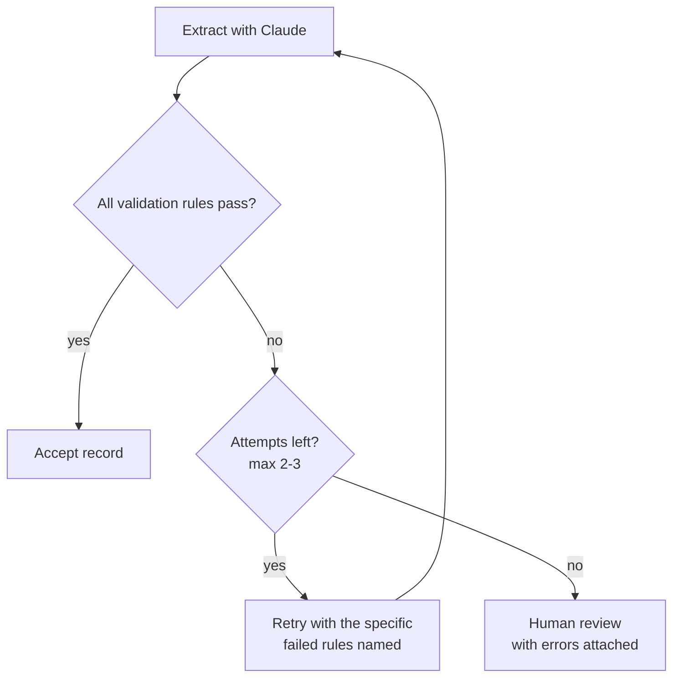

# CCAR-F Domain 3 – Prompt Engineering & Structured Output (20%)

Nov 13, 2026 · Falaque Dani

Domain 3 is about 12 of the 60 questions. It tests whether you can write prompts that behave predictably, get machine-readable output every time, catch bad output in code, and pick the right processing mode for cost and latency.

How to use this guide: read each section's explanation, study the example, then memorize its exam-trap bullets. The consolidated traps table and key facts at the end are your last-hour review. Code is Python with the official `anthropic` SDK; model IDs are current as of November 2026.

The exam's recurring theme here: **make the requirement explicit and checkable.** Vague wording, hoping the model complies, and self-review are the usual wrong answers.

## 3.1 Explicit criteria vs vague instructions

Vague quality words do not change model behaviour reliably; concrete, categorical criteria do. When a prompt produces too many false positives, the fix is to define precisely what counts and what does not.

### Why vague instructions fail

- Words like "be conservative", "only flag important issues" or "high confidence only" mean different things in different contexts. The model has no shared threshold with you.
- Asking the model to self-filter by confidence is unreliable: its stated confidence is poorly calibrated.
- Precise rules give the model a decision procedure. It can check an input against a rule; it cannot check it against "important".

### Example: a code-review prompt that floods developers with false positives

**Before (vague):**

```text
You are a code reviewer. Review this pull request and report any security
issues. Be conservative and only report issues you are confident about.
```

Result: dozens of comments on parameterized queries, test fixtures and constants. Developers start ignoring the bot.

**After (explicit categories, inclusions and exclusions):**

```text
You review pull requests for security defects. Report ONLY these categories:

1. SQL injection: SQL built by string concatenation or f-strings that include
   request data. Do NOT report parameterized queries, ORM query builders,
   or SQL built only from constants.
2. Hard-coded secrets: API keys, passwords or tokens in source files.
   Do NOT report placeholders like "changeme" or values in tests/fixtures/.
3. Missing authorization: a new HTTP handler that reads or writes user data
   without calling require_auth(). Do NOT report health-check endpoints.

Do not report style, performance or naming issues.

Assign severity using these definitions:
- critical: exploitable from the internet with no login (e.g., SQL injection
  in a public endpoint)
- high: exploitable by a logged-in user (e.g., missing ownership check)
- medium: needs unusual conditions (e.g., secret in a private admin script)

If nothing matches a category, return an empty list.
```

What changed: each category has a definition, examples of what to report, and explicit exclusions. Severity has a definition plus an example per level. There is a defined "nothing found" outcome, so the model is not pressured to find something.

### Tuning when one category is noisy

- Measure false positives per category, not overall.
- Tighten the noisy category's definition and add exclusions. If it still cannot be made precise, disable that category temporarily rather than weakening the whole prompt; trust in the other categories recovers.
- Explain *why* a rule exists ("developers ignore the bot if it flags test fixtures"). Claude generalizes from the reason to cases you did not list.

### Exam traps

- "Add 'be more conservative' / 'only high-confidence issues' to the prompt" is the classic wrong answer to false positives. Correct: explicit categorical criteria with exclusions.
- "Have the model output a confidence score and filter below 0.8" sounds rigorous but relies on uncalibrated self-assessment.
- Severity labels without definitions and examples drift; the fix is a definition plus an example per level.

## 3.2 Few-shot prompting

A few well-chosen examples teach format and judgment faster than paragraphs of rules. The skill tested is choosing the *right* examples: diverse, covering edge cases, and showing what to do when data is missing.

### Rules of thumb

| Guideline | Why |
| --- | --- |
| 3–5 examples is typical | Enough to show the pattern without bloating every request |
| Make them diverse | Identical-looking examples teach the surface format, not the rule; the model may copy their length or wording |
| Include the hard cases | Ambiguous inputs are where the model errs; show the correct call and a one-line reason |
| Show missing-data handling | An example with `null` fields teaches "don't invent" better than an instruction alone |
| Wrap in `<example>` tags | Separates examples from instructions and real input; nest several inside `<examples>` |
| Keep examples consistent with the rules | An example that contradicts an instruction confuses the model; examples usually win |

### Example: classifying support tickets

```text
Classify the ticket into one category: billing, technical, account, other.
If the ticket mixes topics, choose the one the customer needs resolved first.
Return JSON: {"category": ..., "order_id": string or null, "reason": ...}

<examples>
<example>
Ticket: "I was charged twice for order #A-1192."
Output: {"category": "billing", "order_id": "A-1192",
         "reason": "duplicate charge"}
</example>
<example>
Ticket: "App crashes when I open invoices, and I can't see my refund."
Output: {"category": "technical", "order_id": null,
         "reason": "crash blocks access to billing; fix the crash first"}
</example>
<example>
Ticket: "Do you ship to Norway?"
Output: {"category": "other", "order_id": null,
         "reason": "pre-sales question, no account action"}
</example>
</examples>

<ticket>{{TICKET_TEXT}}</ticket>
```

What each example teaches: the first shows the happy path and ID extraction. The second is ambiguous (technical vs billing) and shows the tie-break rule in action, with `order_id: null` because none was given. The third shows the `other` bucket so the model does not force a fit.

### Few-shot vs fine-tuning

For format, tone and edge-case handling, few-shot plus clear instructions is the first tool. Fine-tuning is rarely the expected exam answer: it is slower, costlier and harder to change.

### Exam traps

- "Add more examples of the common case" does not fix errors on rare or ambiguous inputs. Add examples of those edge cases.
- All-similar examples cause over-fitting to one format. The fix is varied structures and lengths.
- If the model invents values for missing fields, add an example with `null` (and make the schema field nullable, see 3.4).

## 3.3 Prompt structure

A well-structured prompt separates instructions from data, puts long material before the question, and gives the model room to reason on hard tasks.

### The building blocks

- **XML tags to separate parts.** `<instructions>`, `<document>`, `<examples>`, `<ticket>`. Claude is trained to respect these boundaries. Tags also stop data from being read as instructions (useful against prompt injection in user content).
- **Long documents first, question last.** For long inputs (contracts, logs, codebases), put the material at the top and the task at the bottom. This measurably improves quality on long contexts.
- **A role in the system prompt.** "You are a senior tax accountant reviewing invoices for a UK firm" sets vocabulary, standards and tone.
- **Explain why.** "Never use ellipses, because a text-to-speech engine will read this" generalizes better than "never use ellipses".
- **Say what to do, not only what to avoid.** "Write in flowing paragraphs" beats "don't use bullet points".
- **Ask for quotes first on long documents.** Have Claude extract the relevant passages into `<quotes>` tags, then answer from them. This grounds the answer and reduces hallucination.

### Example skeleton

```python
system = (
    "You are a contracts analyst for a mid-size software company. "
    "Your summaries go to non-lawyers, so use plain English."
)

user = f"""<contract>
{contract_text}
</contract>

<instructions>
1. Quote every clause about termination or renewal inside <quotes> tags.
2. Using only those quotes, list each notice period and auto-renewal term.
3. If the contract is silent on a point, write "not specified"; do not infer.
</instructions>"""
```

### Reasoning: chain of thought and extended thinking

- For multi-step problems (calculations, multi-criteria decisions, debugging), let Claude reason before the final answer. Without visible or internal reasoning, accuracy drops on complex tasks.
- On current models, use adaptive thinking (`thinking={"type": "adaptive"}`) and steer depth with `output_config={"effort": "low" | "medium" | "high" | "xhigh" | "max"}`. The old fixed `budget_tokens` setting is rejected on Claude Opus 5.5, Sonnet 5.5 and Haiku 5.5.
- Without thinking, ask for reasoning in `<thinking>` tags followed by the answer in `<answer>` tags, so code can strip the reasoning.
- Do not demand reasoning for trivial tasks (classification of short text): it adds latency and cost with little gain.

### Exam traps

- Putting a long document *after* the question is a known quality loss on long inputs. Long material first.
- Mixing user-supplied text into instructions without tags invites the model to follow instructions hidden in the data. Wrap untrusted content in tags and tell Claude it is data.
- Assistant-message prefill (starting Claude's reply with `{`) returns an error on current models (Opus 5.5, Sonnet 5.5, Haiku 5.5). For guaranteed JSON, use structured outputs or tools, not prefill.

## 3.4 Structured output with tool use and JSON schemas

The reliable way to get machine-readable output is to define a JSON schema and have Claude fill it, either as a tool call or through structured outputs. Asking for "JSON please" in plain text is the fragile option.

### Pattern 1: an extraction tool plus forced tool\_choice

You define a tool whose `input_schema` is the record you want. Claude never "runs" it; the tool call's `input` IS your structured data. Forcing `tool_choice` guarantees Claude calls it instead of replying in prose.

```python
import anthropic

client = anthropic.Anthropic()

extract_invoice = {
    "name": "record_invoice",
    "description": "Record the fields extracted from one invoice document.",
    "strict": True,  # arguments must validate exactly against the schema
    "input_schema": {
        "type": "object",
        "properties": {
            "vendor_name": {"type": "string"},
            "invoice_number": {"type": ["string", "null"]},   # nullable
            "invoice_date": {"type": ["string", "null"],
                             "description": "YYYY-MM-DD, or null if absent"},
            "document_type": {"type": "string",
                              "enum": ["invoice", "credit_note", "receipt", "other"]},
            "document_type_detail": {"type": ["string", "null"],
                                     "description": "Explain if document_type is 'other'"},
            "line_items": {
                "type": "array",
                "items": {
                    "type": "object",
                    "properties": {
                        "description": {"type": "string"},
                        "amount": {"type": "number"},
                    },
                    "required": ["description", "amount"],
                    "additionalProperties": False,
                },
            },
            "stated_total": {"type": ["number", "null"]},
        },
        "required": ["vendor_name", "invoice_number", "invoice_date",
                     "document_type", "document_type_detail",
                     "line_items", "stated_total"],
        "additionalProperties": False,
    },
}

response = client.messages.create(
    model="claude-haiku-5-5",          # fast, cheap model for bulk extraction
    max_tokens=4096,
    thinking={"type": "disabled"},     # forced tool_choice needs thinking off
    tools=[extract_invoice],
    tool_choice={"type": "tool", "name": "record_invoice"},  # must call it
    messages=[{"role": "user",
               "content": f"<document>\n{invoice_text}\n</document>"}],
)

tool_call = next(b for b in response.content if b.type == "tool_use")
invoice = tool_call.input   # a dict that matches the schema
```

### All tool\_choice values

| Value | Behaviour | Use when |
| --- | --- | --- |
| `{"type": "auto"}` | Claude decides whether to call a tool (default when tools are given) | Normal agents and chat |
| `{"type": "any"}` | Must call one of the tools; Claude picks which | Every turn must be an action, several valid tools |
| `{"type": "tool", "name": "x"}` | Must call that exact tool | Guaranteed structured extraction; a mandatory first step |
| `{"type": "none"}` | Must not call tools | Final summary turn while tools stay defined |

Version note for real projects: Claude Opus 5.5 and Sonnet 5.5 reject forced `any`/`tool` with a 400 error. On those models, use Pattern 2 or `auto` plus `strict: true` and a prompt that names the tool. The exam's concept still holds: **forcing the output shape is the answer when free text is unreliable.**

### Pattern 2: structured outputs (`output_config.format`)

Constrains Claude's text reply itself to a JSON schema. No tool needed.

```python
import json

response = client.messages.create(
    model="claude-opus-5-5",
    max_tokens=16000,
    output_config={"format": {"type": "json_schema",
                              "schema": extract_invoice["input_schema"]}},
    messages=[{"role": "user",
               "content": f"<document>\n{invoice_text}\n</document>\n"
                          "Extract the invoice fields."}],
)
text = next(b.text for b in response.content if b.type == "text")
invoice = json.loads(text)
```

With Pydantic, `client.messages.parse(..., output_format=InvoiceModel)` returns a validated object in `response.parsed_output`.

### Syntax vs semantics: what a strict schema does NOT do

| Guaranteed by a strict schema | NOT guaranteed |
| --- | --- |
| Valid, parseable JSON | That the vendor name is the right one |
| All required fields present | That the amounts add up |
| Correct types and enum values | That the date is real and correctly read |
| No unexpected extra fields | That a value exists in the source at all |

That is why 3.5 adds validation in code.

### Schema design that prevents hallucination

- **Nullable fields** (`"type": ["string", "null"]`) for facts that may be missing. A required non-null field forces the model to invent something.
- **"other" / "unclear" enum values plus a detail field**, so an unexpected input is captured honestly instead of being squeezed into the nearest category.
- Field `description`s carry format rules ("YYYY-MM-DD"), which the model reads.

### Exam traps

- "Ask for JSON in the prompt and parse with a regex" is fragile. Correct: a tool schema with forced `tool_choice`, or structured outputs.
- "Strict mode guarantees correct data" is false. It guarantees syntax; you still validate meaning.
- A required, non-nullable field for an often-missing fact is the root cause of invented values. Make it nullable.

## 3.5 Validation and retry loops

After extraction, check the result in code against business rules. If it fails, retry once or twice with the specific error fed back. If it still fails, or the information simply is not in the source, stop retrying and flag it for a human.

### What to validate in code

- **Business rules:** line items sum to the stated total; end date after start date; quantity times unit price equals amount.
- **Formats:** dates parse, IDs match a pattern, currency codes are valid.
- **Cross-field logic:** if `document_type` is `"other"`, `document_type_detail` must be filled.
- **Reference data:** the vendor exists in your vendor table; the PO number exists.

### Example: validate, retry with error feedback, then escalate

This builds on the `record_invoice` tool from 3.4. On failure, the validation errors go back to Claude as an error `tool_result`, so it knows exactly what to fix.

```python
import re

MAX_ATTEMPTS = 3

def validate(inv: dict) -> list[str]:
    errors = []
    items_sum = round(sum(i["amount"] for i in inv["line_items"]), 2)
    if inv["stated_total"] is not None and abs(items_sum - inv["stated_total"]) > 0.01:
        errors.append(f"stated_total {inv['stated_total']} does not equal "
                      f"the sum of line_items {items_sum}")
    if inv["invoice_date"] and not re.fullmatch(r"\d{4}-\d{2}-\d{2}", inv["invoice_date"]):
        errors.append("invoice_date must be YYYY-MM-DD")
    if inv["document_type"] == "other" and not inv["document_type_detail"]:
        errors.append("document_type_detail is required when document_type is 'other'")
    return errors

def extract_with_retry(invoice_text: str) -> dict:
    messages = [{"role": "user",
                 "content": f"<document>\n{invoice_text}\n</document>"}]
    for attempt in range(MAX_ATTEMPTS):
        response = client.messages.create(
            model="claude-haiku-5-5", max_tokens=4096,
            thinking={"type": "disabled"},
            tools=[extract_invoice],
            tool_choice={"type": "tool", "name": "record_invoice"},
            messages=messages,
        )
        call = next(b for b in response.content if b.type == "tool_use")
        errors = validate(call.input)
        if not errors:
            return {"status": "ok", "invoice": call.input}

        # Feed the specific errors back and ask for a corrected call
        messages.append({"role": "assistant", "content": response.content})
        messages.append({"role": "user", "content": [{
            "type": "tool_result",
            "tool_use_id": call.id,
            "is_error": True,
            "content": "Validation failed:\n- " + "\n- ".join(errors) +
                       "\nRe-read the document and call record_invoice again. "
                       "Copy values exactly as printed; do not adjust numbers "
                       "to make them add up.",
        }]})

    # Still failing: route to a human with the evidence
    return {"status": "needs_review", "invoice": call.input, "errors": errors}
```

Key design points: the retry message names each failed rule, not just "try again". Attempts are capped (2–3). The final fallback is human review with the errors attached, never silent acceptance.



A record is accepted only when every rule passes; otherwise it loops back with specific errors at most twice more, then goes to a human.

### When retrying cannot help

- **The information is absent.** If the invoice has no invoice number, `null` is the correct answer. Retrying with "invoice\_number is required" pressures the model to invent one.
- **The source itself is inconsistent.** If the printed total really does not match the printed items (the vendor made an error, or tax is shown separately), no retry will fix it. Record both values and flag the conflict.
- **The input is unreadable.** A blurry scan or truncated file needs a better input or a human, not more attempts.

### Make discrepancies visible in the schema

Instead of letting the model quietly "correct" one number, add fields that capture the conflict:

| Field | Purpose |
| --- | --- |
| `stated_total` | The total exactly as printed |
| `calculated_total` | The sum of the extracted line items |
| `conflict_detected` | `true` when the two disagree |
| `detected_pattern` | Why it was flagged, e.g., "tax shown separately" or "discount line missing"; lets you count recurring causes |

This turns a silent error into a reviewable record, and `detected_pattern` lets you spot systematic issues (for example, one vendor always excludes VAT from line items) and fix them upstream.

### Exam traps

- "Retry until the field is filled" is wrong when the data is not in the source: it manufactures hallucinations. Return `null` or route to review.
- A retry without the specific error ("that was wrong, try again") rarely helps. Feed back the exact failed rule.
- Unlimited retries waste cost and hide real data problems. Cap attempts, then escalate with evidence.

## 3.6 Message Batches API

The Message Batches API runs many independent Messages requests asynchronously at half price, finishing within 24 hours. Use it when nobody is waiting for the answer; never for anything that blocks a user or a pipeline.

### Facts to know cold

| Fact | Value |
| --- | --- |
| Price | 50% of standard input and output token prices |
| Turnaround | Most batches finish within 1 hour; maximum 24 hours; no latency guarantee |
| Size limit | Up to 100,000 requests or 256 MB per batch |
| Matching results | Each request carries a `custom_id`; results can arrive in any order, so match by `custom_id`, never by position |
| Result types | `succeeded`, `errored`, `canceled`, `expired` |
| Result retention | Results downloadable for 29 days |
| Conversation | Each request is a single, independent Messages call; no multi-turn tool loop inside a batch |
| Features | Most Messages features work (tools, vision, caching, system prompts); streaming does not |

### Example: overnight extraction of 20,000 invoices

```python
import time
import anthropic
from anthropic.types.message_create_params import MessageCreateParamsNonStreaming
from anthropic.types.messages.batch_create_params import Request

client = anthropic.Anthropic()

batch = client.messages.batches.create(
    requests=[
        Request(
            custom_id=doc["id"],   # your own key, used to match results
            params=MessageCreateParamsNonStreaming(
                model="claude-haiku-5-5",
                max_tokens=4096,
                thinking={"type": "disabled"},
                tools=[extract_invoice],
                tool_choice={"type": "tool", "name": "record_invoice"},
                messages=[{"role": "user",
                           "content": f"<document>\n{doc['text']}\n</document>"}],
            ),
        )
        for doc in documents
    ]
)

# Poll until processing has ended
while client.messages.batches.retrieve(batch.id).processing_status != "ended":
    time.sleep(60)

results, to_retry = {}, []
for r in client.messages.batches.results(batch.id):
    if r.result.type == "succeeded":
        call = next(b for b in r.result.message.content if b.type == "tool_use")
        results[r.custom_id] = call.input        # keyed by custom_id
    else:                                        # errored / canceled / expired
        to_retry.append(r.custom_id)
```

After collecting results, run the same `validate()` from 3.5. Failed or invalid documents go into a follow-up batch or to human review.

### When a batch is the wrong choice

| Situation | Use instead | Why |
| --- | --- | --- |
| Pre-merge code check that blocks a pull request | Real-time Messages API | A developer waits; batches can take up to 24 hours |
| Customer-facing chat or support agent | Real-time (streaming) | Interactive and latency-sensitive |
| Agent that needs several tool-call rounds | Real-time agent loop | A batch request is one call; you cannot answer its tool calls mid-request |
| Nightly report over 50,000 documents | **Batch** | No one waits; halves the cost |
| Re-scoring an evaluation set | **Batch** | Large, independent, not urgent |

A common pattern is hybrid: the blocking check runs in real time on the changed files, while a deeper nightly audit of the whole repository runs as a batch.

### Exam traps

- "Use the Batch API to cut the cost of the blocking pre-merge check" is the classic trap. No latency guarantee means it cannot gate a workflow.
- Matching results by list position is a bug. Results come back in any order; use `custom_id`.
- A batch cannot run a multi-turn agent loop. Each request is independent; tool calls inside it would need a new request to answer.

## 3.7 Prompt caching and how it combines with batches

Prompt caching reuses an identical prompt prefix across requests, cutting cost and latency on the repeated part. It suits prompts with a large fixed preamble (system prompt, few-shot examples, a long document) and a small changing tail.

### How it works

- **Prefix match.** The cache key is the exact bytes from the start of the prompt up to a `cache_control` breakpoint. Any change earlier in the prompt invalidates everything after it.
- **Render order:** `tools` → `system` → `messages`. Put stable content first and changing content (the user's question, timestamps, IDs) last.
- **Pricing:** cache writes cost a premium (about 1.25× base input for the 5-minute cache, 2× for the 1-hour cache); cache reads cost a small fraction of base input (about 10% on most models; 5% on Opus 5.5 and Sonnet 5.5).
- **Lifetime:** 5 minutes by default, refreshed on each hit; `"ttl": "1h"` for gaps longer than 5 minutes.
- **Limits:** up to 4 breakpoints per request; a model-specific minimum prefix length (prefixes that are too short silently do not cache).
- **Check it works:** `usage.cache_read_input_tokens` should be non-zero on repeat requests.

### Example: cache the shared preamble, vary the question

```python
response = client.messages.create(
    model="claude-opus-5-5",
    max_tokens=16000,
    system=[
        {"type": "text", "text": REVIEW_RULES},          # stable instructions
        {"type": "text", "text": FEW_SHOT_EXAMPLES,      # stable examples
         "cache_control": {"type": "ephemeral"}},        # breakpoint here
    ],
    messages=[{"role": "user", "content": diff_text}],  # changes every call
)
print(response.usage.cache_read_input_tokens)
```

The breakpoint sits at the end of the shared portion. Putting a timestamp or request ID in the system prompt would break the cache on every call.

### Caching plus batches

- The two discounts combine: batch pricing halves the cost and cached tokens are billed at the cache-read rate.
- Put the shared preamble with `cache_control` in every batch request's `system`. Because batch requests run in parallel, cache hits are best-effort rather than guaranteed.
- Caching also helps the validation-retry loop in 3.5: the retry resends the same document, so the long prefix is read from cache.

### Exam traps

- Dynamic content (dates, user IDs) placed before the breakpoint means nothing is ever reused. Stable first, variable last.
- Caching reduces cost and latency of the *repeated* input. It does not change output quality or output token cost.
- "Use caching to make a slow interactive feature acceptable" can be right for latency, but caching does not replace the Batch API's 50% discount for non-urgent bulk work, or vice versa. Pick by whether someone is waiting.

## 3.8 Multi-instance and multi-pass review

A model reviewing its own work in the same conversation tends to agree with itself. Reliable review uses a separate instance that sees only the output and the criteria, and splits large reviews into focused passes.

### Why self-review is weak

- The generating conversation contains the model's own reasoning. When asked "is this correct?", it re-reads that reasoning and finds it convincing.
- An independent instance starts fresh: no generation history, only the artifact plus the review criteria. It is more likely to spot what the author missed.
- The independent reviewer can use different instructions (strict checklist), a different model or a different temperature of scrutiny.

### Example: independent reviewer

```python
def generate(spec: str) -> str:
    r = client.messages.create(
        model="claude-opus-5-5", max_tokens=16000,
        messages=[{"role": "user", "content": f"<spec>\n{spec}\n</spec>\nWrite the function."}],
    )
    return next(b.text for b in r.content if b.type == "text")

def review(spec: str, code: str) -> str:
    # New conversation: the reviewer never sees the generator's reasoning
    r = client.messages.create(
        model="claude-opus-5-5", max_tokens=16000,
        system="You are a strict code reviewer. Report only defects that break "
               "the spec, with the line and a one-line fix. If none, reply NONE.",
        messages=[{"role": "user",
                   "content": f"<spec>\n{spec}\n</spec>\n<code>\n{code}\n</code>"}],
    )
    return next(b.text for b in r.content if b.type == "text")
```

The same idea applies in Claude Code CI: run the review as a separate `claude -p` session, not as a follow-up in the session that wrote the code.

### Multi-pass review for large changes

One pass over a 40-file pull request dilutes attention: issues in the middle files get missed and cross-file problems are noticed inconsistently.

| Pass | Scope | Catches |
| --- | --- | --- |
| Per-file pass | One file at a time (can run in parallel) | Local bugs, unsafe calls, missing error handling |
| Cross-file pass | Summaries of all files plus the interfaces between them | Broken contracts, mismatched types, a renamed function still called by its old name |

Run the per-file passes first, then feed their compact findings and the changed interfaces into the cross-file pass. Deduplicate before posting so developers do not see the same issue twice.

### Voting and multiple samples

For high-stakes classification, run several independent instances and compare. Agreement raises confidence; disagreement is a signal to route the item to a human.

### Exam traps

- "Ask the same conversation to double-check its answer" is the weak option. Use an independent instance without the generation context.
- "Review all 40 files in one prompt with a bigger context window" misses issues. Split into per-file and cross-file passes.
- Re-running a reviewer without passing previous findings creates duplicate comments. Pass earlier findings in and ask for new issues only.

## Exam traps: consolidated

Most wrong options in this domain are one of these 15 patterns. Eliminate them first.

| # | Tempting wrong answer | Correct answer | Section |
| --- | --- | --- | --- |
| 1 | Add "be conservative" or "only high-confidence issues" to cut false positives | Explicit categories with inclusions, exclusions and examples | 3.1 |
| 2 | Filter findings by the model's self-reported confidence | Precise criteria; confidence is poorly calibrated | 3.1 |
| 3 | Severity levels named but not defined | A definition plus an example per level | 3.1 |
| 4 | Add more examples of the common case | Add examples of the ambiguous and edge cases | 3.2 |
| 5 | Several near-identical few-shot examples | Diverse examples, including a `null` / missing-data case | 3.2 |
| 6 | Put the long document after the question | Long material first, question last | 3.3 |
| 7 | Ask for JSON in plain text and parse with regex | Tool schema with forced `tool_choice`, or structured outputs | 3.4 |
| 8 | Strict schema means the data is correct | Strict schema guarantees syntax only; validate meaning in code | 3.4 |
| 9 | Required non-null field for an often-missing value | Nullable field, so missing is `null` not invented | 3.4 |
| 10 | Force every input into the existing enum values | Add `"other"` / `"unclear"` plus a detail field | 3.4 |
| 11 | Retry until a missing field is filled | Retrying cannot create absent data; return `null` or route to review | 3.5 |
| 12 | Retry with "try again" and no specifics | Feed back the exact failed rule; cap attempts; then escalate | 3.5 |
| 13 | Use the Batch API for a blocking pre-merge check | Real-time API; batches have no latency guarantee (up to 24 h) | 3.6 |
| 14 | Match batch results by list order | Match by `custom_id`; order is not preserved | 3.6 |
| 15 | Let the same conversation review its own output | An independent reviewer instance; per-file plus cross-file passes for large changes | 3.8 |

## Key facts to memorize

- **tool\_choice:** `auto` (default, Claude decides) · `any` (must use some tool) · `{"type": "tool", "name": ...}` (must use that tool) · `none` (no tools).
- **Structured output, two ways:** a tool's `input_schema` + forced `tool_choice`, or `output_config={"format": {"type": "json_schema", "schema": ...}}`. `"strict": true` on a tool validates its arguments exactly.
- **Strict schemas need** `additionalProperties: false` and a `required` list. They fix syntax, not semantics.
- **Nullable:** `"type": ["string", "null"]`. **Escape hatch enums:** `"other"` / `"unclear"` + detail field.
- **Discrepancy fields:** `stated_total`, `calculated_total`, `conflict_detected`, `detected_pattern`.
- **Retry loop:** validate in code → feed back the specific error (an `is_error` tool\_result works well) → cap at 2–3 attempts → human review with evidence.
- **Batches:** 50% cheaper · most finish within 1 h, max 24 h, no latency guarantee · up to 100,000 requests / 256 MB · results in any order, match by `custom_id` · one call per request, no multi-turn · results kept 29 days.
- **Caching:** prefix match · order `tools` → `system` → `messages` · `cache_control: {"type": "ephemeral"}` · 5-min default TTL, `"ttl": "1h"` option · up to 4 breakpoints · reads are a small fraction of input price, writes cost a premium · check `cache_read_input_tokens`.
- **Prompt structure:** XML tags around data · long documents first, question last · role in the system prompt · explain why · quotes before answers on long documents.
- **Few-shot:** 3–5 diverse examples in `<example>` tags, including edge cases and a missing-data case.
- **Thinking on current models:** `thinking={"type": "adaptive"}` with `output_config={"effort": ...}`; fixed `budget_tokens` and assistant prefill are rejected on Opus 5.5, Sonnet 5.5 and Haiku 5.5.
- **Review:** independent instance, not self-review · per-file pass + cross-file pass · pass earlier findings to avoid duplicates.
