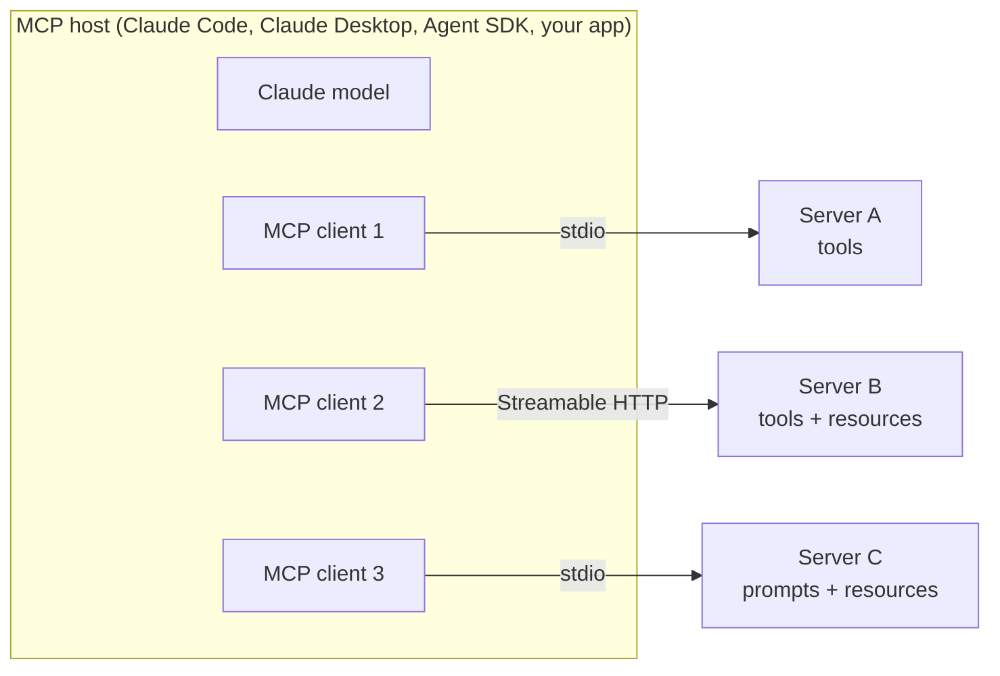

# CCAR-F Domain 4 – Tool Design & MCP Integration (18%)

Nov 13, 2026 · Falaque Dani

Domain 4 is about 18% of the exam (roughly 11 of 60 questions). It tests three skills: writing tools Claude picks correctly, returning results and errors Claude can act on, and connecting MCP servers to Claude Code and agents. Code examples are in Python.

## 4.1 Tool descriptions: how Claude picks a tool

Claude chooses tools almost entirely from their `name`, `description` and `input_schema`. When the wrong tool is picked, the first fix is the description, not more prompt instructions or a bigger model.

A tool definition sent to the Messages API has three required parts:

| Field | What it does | Tip |
| --- | --- | --- |
| `name` | Identifier Claude calls | Verb + object, unique: `lookup_order`, not `order` |
| `description` | The main signal for WHEN to use the tool | 3–6 sentences: purpose, when to use, when not to, inputs, output |
| `input_schema` | JSON Schema for the arguments | Describe every property; use `enum` for closed sets; mark `required` |

Optional: `strict: true` on the tool guarantees the arguments match the schema exactly (the schema then needs `additionalProperties: false`).

### Bad vs good definition

A weak definition. Claude has to guess what "info" means, what ID format to pass and when this beats other tools:

```python
bad_tool = {
    "name": "get_info",
    "description": "Gets order info.",
    "input_schema": {
        "type": "object",
        "properties": {"id": {"type": "string"}},
    },
}
```

A strong definition. It states purpose, boundaries, input format and output:

```python
good_tool = {
    "name": "lookup_order",
    "description": (
        "Look up ONE order by its order number and return its status, items, "
        "total and shipping address. Use this when the customer gives an order "
        "number (format ORD-12345). Do NOT use it to search orders by customer "
        "name or email; use search_orders_by_customer for that. Returns "
        "found=false if the order number does not exist."
    ),
    "input_schema": {
        "type": "object",
        "properties": {
            "order_number": {
                "type": "string",
                "description": "Order number in the form ORD-12345",
                "pattern": "^ORD-[0-9]{5}$",
            }
        },
        "required": ["order_number"],
        "additionalProperties": False,
    },
    "strict": True,
}
```

What changed: a specific name, when to use and when NOT to use, the input format with a pattern, what comes back (including the not-found case), and a pointer to the sibling tool.

**Exam traps**

- "Add few-shot examples to the system prompt" when the real problem is a vague tool description. Fix the description first.
- "Switch to a larger model" to fix tool selection. Descriptions are cheaper and more reliable.
- Thinking `strict: true` makes Claude choose the right tool. It only guarantees valid arguments, not the right choice.

## 4.2 Overlapping tools, prompt conflicts and tool scoping

Most tool-selection failures come from three causes: tools whose purposes overlap, a system prompt that pulls Claude toward one tool, or simply too many tools in view.

### Overlapping tools

Symptom: Claude alternates between two tools for the same request, or calls both. Example pair: `search_orders` ("Find orders") and `get_order_details` ("Get order information"). Both descriptions match "Where is my order ORD-12345?".

Fixes, in order of preference:

1. **Sharpen the boundaries.** State the input each one takes and point to the other: "Use when you have an order number" vs "Use when you only have the customer's email".
2. **Rename** so the names alone signal the difference: `lookup_order_by_number`, `search_orders_by_customer`.
3. **Merge** them into one tool with clear parameters if they are really the same operation.

### System-prompt keyword conflicts

The system prompt can override good descriptions. If it says "Always search the knowledge base first", Claude may call `search_kb` even when the user gave an order number that `lookup_order` handles directly. When selection is wrong, read the system prompt for words that echo a tool name or push a default.

### Tool count and per-role scoping

- Selection accuracy drops as the number of tools grows. 18 tools in one agent is a red flag; 4–6 well-separated tools per agent is a healthy target.
- Give each agent or subagent only the tools its role needs (least privilege). This also limits damage when the agent makes a mistake.
- For very large tool libraries, the API's tool search feature (`defer_loading: true` on tools plus a tool search tool) lets Claude load definitions only when needed.

| Role | Tools it should get | Tools it should NOT get |
| --- | --- | --- |
| Research subagent | `web_search`, `fetch_page`, `read_doc` | `send_email`, `process_refund` |
| Support agent | `get_customer`, `lookup_order`, `escalate_to_human` | Database admin tools |
| Refund step / coordinator | `process_refund` (behind a verification gate) | Web browsing |

**Exam traps**

- "Give every agent access to all tools so it is flexible." Wrong: more tools means worse selection and more risk.
- Fixing overlap by adding "prefer tool A" to the system prompt while leaving both descriptions vague. Fix the descriptions.
- Missing that the system prompt itself causes the wrong choice; the scenario often hides the cause there.

## 4.3 Tool interface design: fewer, higher-level tools with useful output

Design tools around the tasks an agent performs, not around your API endpoints, and return only what Claude needs to take the next step.

### Higher-level tools vs thin API wrappers

Thin wrappers force Claude to chain many calls, each one a chance to fail and each result filling context:

```python
# Thin wrappers: 3+ calls and lots of raw JSON to book one meeting
list_users()          # returns 500 users
list_events(user_id)  # returns a month of events per user
create_event(...)
```

One task-level tool does the same job in a single call:

```python
schedule_meeting = {
    "name": "schedule_meeting",
    "description": (
        "Find the first slot when all attendees are free and book a meeting. "
        "Use when the user asks to set up a meeting with named people. "
        "Returns the booked time and the attendee names, or the reason no "
        "slot was found in the date range."
    ),
    "input_schema": {
        "type": "object",
        "properties": {
            "attendee_emails": {"type": "array", "items": {"type": "string"}},
            "duration_minutes": {"type": "integer"},
            "earliest_date": {"type": "string", "description": "YYYY-MM-DD"},
            "latest_date": {"type": "string", "description": "YYYY-MM-DD"},
        },
        "required": ["attendee_emails", "duration_minutes"],
    },
}
```

### Return concise, meaningful output

| Do | Avoid |
| --- | --- |
| Human-readable names (`"customer": "Priya Shah"`) | Opaque IDs only (`"cust_id": "8f3a-..."`) unless a later tool needs them |
| The 5–10 fields the next step needs | The full 60-field API payload |
| Pagination or a `limit` parameter, plus a total count | Returning 10,000 rows at once |
| Truncation with a note: "showing 20 of 312; refine the query" | Silent truncation that looks like the full result |
| An optional `response_format: "concise" \| "detailed"` parameter | One fixed, verbose format |

If you cannot change the tool itself (a third-party API), trim its output before Claude sees it. In the Agent SDK or Claude Code, a `PostToolUse` hook is the place to normalize and shorten results.

**Exam traps**

- Returning raw API JSON "so Claude has everything". It wastes context and buries the useful fields.
- Silent truncation: Claude concludes the list is complete. Always say when results are cut.
- Building one tool per API endpoint when the agent's job is a higher-level task.

## 4.4 Structured error responses

A tool failure goes back to Claude as a result it can reason about, never as an exception that kills the loop or an empty value that looks like success.

### Where the error flag lives

| Layer | Flag | Notes |
| --- | --- | --- |
| Messages API | `"is_error": true` on the `tool_result` block | Keep the block; never drop a failed call's result |
| MCP protocol | `"isError": true` on the tool call result | Protocol-level errors (unknown tool, bad request) are separate JSON-RPC errors |

### What to put in an error

| Field | Example values | Why Claude needs it |
| --- | --- | --- |
| `error_category` | `transient`, `validation`, `permission`, `not_found`, `business_rule` | Decides the next move: retry, fix input, ask the user, escalate |
| `retryable` | `true` / `false` | Stops pointless retries on permanent failures |
| `message` | "Order service timed out after 5 s" | Readable cause |
| `suggested_action` | "Retry once; if it fails again, tell the customer and escalate" | Steers recovery |

### Access failure vs valid empty result

This is the single most tested idea in error design. "The database timed out" and "this customer has no orders" are different facts. If both come back as `[]`, the agent tells the customer they have no orders.

```python
import json

def lookup_orders(tool_use_id: str, customer_id: str) -> dict:
    try:
        orders = orders_db.find(customer_id=customer_id, timeout=5)
    except TimeoutError:
        # ACCESS FAILURE: we do not know whether orders exist
        return {
            "type": "tool_result",
            "tool_use_id": tool_use_id,
            "is_error": True,
            "content": json.dumps({
                "error_category": "transient",
                "retryable": True,
                "message": "Order database timed out after 5 seconds.",
                "suggested_action": "Retry once. Do not tell the customer they have no orders.",
            }),
        }
    except PermissionError:
        return {
            "type": "tool_result",
            "tool_use_id": tool_use_id,
            "is_error": True,
            "content": json.dumps({
                "error_category": "permission",
                "retryable": False,
                "message": "Service account cannot read orders for this region.",
                "suggested_action": "Escalate to a human agent.",
            }),
        }

    # VALID RESULT: the query worked; an empty list is a real answer
    return {
        "type": "tool_result",
        "tool_use_id": tool_use_id,
        "content": json.dumps({
            "customer_id": customer_id,
            "order_count": len(orders),
            "orders": [summarize(o) for o in orders[:20]],
        }),
    }
```

### Retry locally or propagate?

- **Transient** (timeouts, rate limits, 503): retry inside the tool or subagent with a small limit and backoff. The coordinator never needs to know.
- **Permanent** (permission, validation, business rule): do not retry. Return a structured error, and in multi-agent systems propagate it to the coordinator with context: what failed, what was tried, any partial results.
- The coordinator then continues with what succeeded and records the gap ("orders unavailable; answer based on account data only").

**Exam traps**

- Returning an empty list or "no results" when the call actually failed.
- Raising an exception that crashes the agent loop instead of returning an error result.
- Retrying a permission or validation error; it will fail the same way every time.
- A subagent silently swallowing an error so the final report looks complete.

## 4.5 tool\_choice: letting Claude decide vs forcing a tool

`tool_choice` controls whether and which tool Claude must call. For the exam, know all four values and pick "force" when a step must always happen.

| Value | Behaviour | Use when |
| --- | --- | --- |
| `{"type": "auto"}` | Claude decides whether to call a tool (default when tools are given) | Normal agent turns |
| `{"type": "any"}` | Claude must call some tool; it picks which | Every turn must act, e.g. a router that must choose one handler |
| `{"type": "tool", "name": "extract_invoice"}` | Claude must call that exact tool | Guaranteed structured extraction; a mandatory first step |
| `{"type": "none"}` | No tool calls | A summary turn where tools must not run |

`disable_parallel_tool_use: true` (alongside `auto`, `any` or `tool`) limits Claude to at most one tool call per turn.

### Example: forcing structured extraction (exam pattern)

```python
import anthropic

client = anthropic.Anthropic()

response = client.messages.create(
    model="claude-opus-5",  # see the model note below
    max_tokens=2048,
    tools=[extract_invoice_tool],
    tool_choice={"type": "tool", "name": "extract_invoice"},
    messages=[{"role": "user", "content": invoice_text}],
)
invoice = next(b.input for b in response.content if b.type == "tool_use")
```

### Model note (real world, November 2026)

The newest models (Claude Opus 5.5, Sonnet 5.5, Fable 5.1 and 5.2) return a 400 error for forced `any` or `tool`. On those models, get the same guarantee with:

- `tool_choice: {"type": "auto"}` + `strict: true` on the tool + a clear instruction naming the tool, or
- structured outputs, when you only want JSON back: `output_config={"format": {"type": "json_schema", "schema": {...}}}`.

The exam tests the concept ("force the tool when it must always run"), so answer with forced `tool_choice` unless the question names one of these models.

**Exam traps**

- Relying on a prompt line ("always call extract\_invoice") when the scenario says the call must happen every time. Forced `tool_choice` (or a schema-guaranteed path) is the deterministic answer.
- Confusing `any` (some tool) with `tool` (one named tool).
- Thinking forcing a tool also guarantees correct values. It guarantees a call with valid structure; you still validate the content.

## 4.6 MCP architecture, primitives and transports

The Model Context Protocol (MCP) is an open standard for connecting AI applications to external tools and data. You write an integration once as an MCP server, and any MCP host (Claude Code, Claude Desktop, the Agent SDK, your own app) can use it.



The host holds the model and one client per server; each server exposes some mix of tools, resources and prompts.

### The three roles

| Role | What it is | Example |
| --- | --- | --- |
| Host | The AI application the user works in; it runs the model and manages clients | Claude Code, Claude Desktop, an Agent SDK app |
| Client | A connector inside the host; one client per server connection (1:1) | Created automatically for each configured server |
| Server | A program that exposes capabilities over MCP | GitHub server, a Postgres server, your orders server |

### The three server primitives

| Primitive | Controlled by | What it is | Example |
| --- | --- | --- | --- |
| Tools | Model | Actions Claude decides to call; can have side effects | `create_issue`, `query_orders` |
| Resources | Application | Read-only data identified by a URI, attached as context | `orders://schema`, a file, a docs index or catalog |
| Prompts | User | Reusable prompt templates the user picks (often shown as slash commands) | `/review-pr`, `summarize-incident` |

Key idea: tools are for doing, resources are for reading. A catalog of database tables or a list of available reports is a good resource; Claude reads it to decide what to query, instead of calling a "list" tool every time.

### Transports

| Transport | Use for | Notes |
| --- | --- | --- |
| stdio | Local servers started as a subprocess | Host launches the command; messages over stdin/stdout |
| Streamable HTTP | Remote or shared servers | One HTTP endpoint; supports auth (OAuth) and streaming |
| SSE (HTTP + Server-Sent Events) | Legacy remote servers | Deprecated; prefer Streamable HTTP for anything new |

### How a session runs

1. The client connects and sends `initialize`; client and server agree on protocol version and capabilities.
2. The client discovers what is available: `tools/list`, `resources/list`, `prompts/list`.
3. The host passes tool definitions to Claude. When Claude calls one, the client sends `tools/call` and returns the result.
4. Servers can send `list_changed` notifications when their tools or resources change.

Clients can also offer features to servers: sampling (server asks the host's model for a completion), roots (which folders the server may use) and elicitation (server asks the user for input).

**Exam traps**

- Mixing up who controls what: tools = model, resources = application, prompts = user.
- Exposing read-only reference data as many "get" tools when a resource (or one catalog resource) fits better.
- Choosing SSE for a new remote server. Streamable HTTP is the current transport.

## 4.7 A minimal Python MCP server (FastMCP)

The official Python SDK (`pip install "mcp[cli]"`) includes FastMCP, which turns decorated functions into MCP tools and resources. The function's docstring becomes the tool description and its type hints become the input schema, so everything in 4.1 applies to how you write them.

```python
# server.py
import json
import re

from mcp.server.fastmcp import FastMCP
from mcp.server.fastmcp.exceptions import ToolError

mcp = FastMCP("orders")


@mcp.tool()
def lookup_order(order_number: str) -> dict:
    """Look up ONE order by its order number (format ORD-12345).

    Use when the customer gives an order number. Do not use it to search by
    customer name or email. Returns status, items and total, or found=false
    if no order has that number.
    """
    if not re.fullmatch(r"ORD-\d{5}", order_number):
        # Validation error: retrying with the same input will not help
        raise ToolError(json.dumps({
            "error_category": "validation",
            "retryable": False,
            "message": f"'{order_number}' is not in the form ORD-12345.",
            "suggested_action": "Ask the customer to confirm the order number.",
        }))
    try:
        order = orders_db.get(order_number, timeout=5)
    except TimeoutError:
        # Access failure: must NOT look like 'order not found'
        raise ToolError(json.dumps({
            "error_category": "transient",
            "retryable": True,
            "message": "Order database timed out.",
            "suggested_action": "Retry once, then escalate.",
        }))
    if order is None:
        return {"found": False, "order_number": order_number}  # valid empty result
    return {"found": True, "order_number": order_number, "status": order.status,
            "total": order.total, "items": [i.name for i in order.items]}


@mcp.resource("orders://status-codes")
def status_codes() -> str:
    """Catalog of order status codes and what each one means."""
    return json.dumps({
        "PENDING": "Paid, not yet packed",
        "SHIPPED": "Handed to the carrier",
        "DELIVERED": "Carrier confirmed delivery",
        "RETURNED": "Refund in progress",
    })


if __name__ == "__main__":
    mcp.run()  # stdio by default; mcp.run(transport="streamable-http") for remote
```

What to notice:

- **Raising `ToolError`** (or any exception) inside a tool makes FastMCP return a tool result with `isError: true` and your message as content. Claude sees the JSON and can act on the category and retry flag.
- **"Not found" is a normal return** (`found: false`), not an error. The timeout is an error. That is the access-failure vs empty-result rule from 4.4.
- **The resource** is read-only reference data with a URI. The host attaches it as context; there is no need for a `get_status_codes` tool.
- Test locally with the MCP Inspector: `mcp dev server.py`. Register it in Claude Code with `claude mcp add orders -- python server.py` (next section).

**Exam traps**

- Returning "order not found" for a timeout, or raising an error for a genuine not-found.
- A one-word docstring: in FastMCP the docstring IS the tool description Claude reads.
- Building a custom MCP server for a system that already has a maintained official server (GitHub, Slack, Jira, Postgres). Use the existing one unless you need custom behaviour.

## 4.8 MCP in Claude Code: scopes, .mcp.json and naming

Where you configure a server decides who gets it. Team servers go in the project's `.mcp.json` (committed); personal servers go in your user or local config.

### The three scopes

| Scope | Stored in | Who gets it | Typical use |
| --- | --- | --- | --- |
| Local (default) | `~/.claude.json`, under this project's path | Only you, only this project | Trying a server; personal credentials for one repo |
| Project | `.mcp.json` at the repo root, committed | Everyone who clones the repo | Servers the whole team needs (issue tracker, internal DB) |
| User | `~/.claude.json` (global section) | Only you, in every project | Personal tools you use everywhere |

If the same server name exists at several scopes, local wins over project, and project wins over user. For safety, Claude Code asks each person to approve project-scoped servers from `.mcp.json` before first use.

### Adding servers from the command line

```bash
# Local stdio server (stdio is the default transport); everything after -- is the command
claude mcp add orders -- python tools/orders_server.py

# Remote server over Streamable HTTP, shared with the team
claude mcp add --transport http --scope project github https://api.githubcopilot.com/mcp/

# Pass environment variables to a stdio server
claude mcp add --env ORDERS_DB_URL=postgres://localhost/orders orders -- python tools/orders_server.py

# Inspect and manage
claude mcp list
claude mcp get github
claude mcp remove orders
```

Inside a session, `/mcp` shows server status and handles OAuth sign-in for remote servers.

### .mcp.json with environment-variable expansion

Never commit secrets. `.mcp.json` expands `${VAR}` (and `${VAR:-default}`) from each developer's environment:

```json
{
  "mcpServers": {
    "github": {
      "type": "http",
      "url": "https://api.githubcopilot.com/mcp/",
      "headers": { "Authorization": "Bearer ${GITHUB_TOKEN}" }
    },
    "orders": {
      "command": "python",
      "args": ["tools/orders_server.py"],
      "env": { "ORDERS_DB_URL": "${ORDERS_DB_URL:-postgres://localhost/orders}" }
    }
  }
}
```

### How MCP shows up inside Claude Code

| MCP primitive | Appears as | Example |
| --- | --- | --- |
| Tool | `mcp__<server>__<tool>` | `mcp__github__create_issue` |
| Resource | An `@` mention | `@orders:orders://status-codes` |
| Prompt | A slash command | `/mcp__github__review_pr` |

The tool name is what you put in permission rules: `"allow": ["mcp__github__create_issue"]`, or `mcp__github` to allow every tool from that server. Very large MCP results trigger a warning and are capped (the `MAX_MCP_OUTPUT_TOKENS` setting raises the cap).

### Use existing servers first

Before writing a server, check for an official or well-maintained community server (GitHub, Jira, Slack, Sentry, Postgres, and many more). Build your own only for internal systems or custom behaviour.

**Exam traps**

- A server the team needs, added at local or user scope. It only works on one laptop. Use `--scope project` / `.mcp.json`.
- An API token written directly into `.mcp.json`. Use `${ENV_VAR}` expansion.
- Calling a tool by its bare name in permissions (`create_issue`) instead of `mcp__github__create_issue`.

## 4.9 MCP in the Agent SDK

The Claude Agent SDK (Claude Code as a library, `pip install claude-agent-sdk`) connects to MCP servers through the `mcp_servers` option and controls which of their tools Claude may use with `allowed_tools`.

### External servers (stdio or HTTP)

```python
import asyncio
import os

from claude_agent_sdk import ClaudeAgentOptions, query

options = ClaudeAgentOptions(
    mcp_servers={
        "orders": {
            "type": "stdio",
            "command": "python",
            "args": ["tools/orders_server.py"],
        },
        "github": {
            "type": "http",
            "url": "https://api.githubcopilot.com/mcp/",
            "headers": {"Authorization": f"Bearer {os.environ['GITHUB_TOKEN']}"},
        },
    },
    # Only these tools are pre-approved; same mcp__<server>__<tool> naming as Claude Code
    allowed_tools=["mcp__orders__lookup_order", "mcp__github__list_issues"],
)


async def main():
    async for message in query(prompt="What is the status of ORD-12345?", options=options):
        print(message)


asyncio.run(main())
```

### In-process tools (SDK MCP server)

For tools that live in your own Python code, skip the separate process: define them with `@tool` and wrap them with `create_sdk_mcp_server`.

```python
from claude_agent_sdk import ClaudeAgentOptions, create_sdk_mcp_server, tool


@tool("get_refund_policy", "Return the refund policy text for one product category",
      {"category": str})
async def get_refund_policy(args):
    policy = POLICIES.get(args["category"])
    if policy is None:
        return {
            "content": [{"type": "text", "text": f"No policy for '{args['category']}'."}],
            "is_error": True,
        }
    return {"content": [{"type": "text", "text": policy}]}


policy_server = create_sdk_mcp_server(name="policy", version="1.0.0",
                                      tools=[get_refund_policy])

options = ClaudeAgentOptions(
    mcp_servers={"policy": policy_server},
    allowed_tools=["mcp__policy__get_refund_policy"],
)
```

### Scoping MCP tools per agent

- The coordinator and each subagent should list only the MCP tools their role needs, in `allowed_tools` or in the subagent's `tools` list (`AgentDefinition`).
- `disallowed_tools` explicitly blocks tools, e.g. a write tool on a read-only research agent.
- For rules that must always hold (no refund over a limit), add a `PreToolUse` hook that inspects the call and denies it. Tool lists decide what is available; hooks enforce how it is used.

A third route exists on the plain Messages API: the MCP connector lets the API itself call a remote MCP server (`mcp_servers` plus an `mcp_toolset` entry in `tools`, beta header `mcp-client-2025-11-20`). It supports remote HTTP servers only, not local stdio ones.

**Exam traps**

- Adding a server to `mcp_servers` and expecting its tools to run without being allowed (or approved by the permission mode).
- Giving a read-only subagent the same MCP write tools as the coordinator.
- Using `allowed_tools` alone to enforce a business limit. It controls which tools exist, not the argument values; use a hook.

## 4.10 Built-in tools in Claude Code and the Agent SDK

Claude Code and the Agent SDK ship with built-in tools. Exam questions give a task and ask which tool fits, or why an edit failed.

| Tool | Use it to | Watch out for |
| --- | --- | --- |
| Glob | Find files by name or path pattern: `src/**/*.test.ts` | Matches names only, not contents |
| Grep | Search file contents with a regex: where `calculate_tax(` is called | Searches contents; use `glob`/`type` filters to narrow it |
| Read | Read a file (text, images, PDFs, notebooks) | Large files: read a line range |
| Edit | Replace an exact string in a file | `old_string` must match exactly and be unique |
| Write | Create a new file or overwrite an entire file | Read an existing file before overwriting it |
| Bash | Run shell commands: tests, builds, git | Prefer Grep/Glob/Read over `grep`/`find`/`cat` |
| WebFetch | Fetch a URL and extract what you ask for | Only public pages; not for authenticated sites |
| WebSearch | Search the web for current information | Returns results to read, not full pages |

Other built-ins you may see: NotebookEdit (Jupyter cells), the Task/Agent tool (start a subagent), and a to-do list tool for tracking multi-step work.

### The Edit uniqueness rule

Edit replaces `old_string` with `new_string`. If `old_string` appears more than once, the edit fails because Claude cannot tell which occurrence you mean.

```python
# config.py contains this line twice (dev and prod sections):
#     timeout = 30

# Fails: old_string matches 2 places
Edit(file_path="config.py", old_string="timeout = 30", new_string="timeout = 60")

# Works: include surrounding context so the match is unique
Edit(file_path="config.py",
     old_string="[prod]\nhost = api.example.com\ntimeout = 30",
     new_string="[prod]\nhost = api.example.com\ntimeout = 60")

# Works when you really mean every occurrence
Edit(file_path="config.py", old_string="timeout = 30", new_string="timeout = 60",
     replace_all=True)
```

If the change is large or the anchor text cannot be made unique, fall back to Read + Write: read the whole file, then write the full new version.

### Picking the right tool: quick drills

| Task | Best tool |
| --- | --- |
| "List every migration file under db/" | Glob (`db/**/*.sql`) |
| "Find every place that calls `send_invoice`" | Grep |
| "Show me lines 200–260 of server.py" | Read with a line range |
| "Rename one variable in one function" | Edit |
| "Replace the whole generated README" | Write |
| "Run the test suite" | Bash |
| "What changed in the library's latest release notes?" | WebSearch, then WebFetch |

**Exam traps**

- Using Grep to find files by name, or Glob to search inside files.
- Retrying the same failing Edit. Add context to make `old_string` unique, use `replace_all`, or switch to Read + Write.
- Using Bash `cat`, `find` or `grep` when the dedicated tools exist; the dedicated tools are safer and give Claude cleaner output.

## Exam traps: the whole domain in one table

Most wrong answers in this domain try to fix a tool problem with a prompt, or hide a failure. Read this table twice before the exam.

| # | Tempting wrong answer | Correct answer |
| --- | --- | --- |
| 1 | Add few-shot examples or a bigger model when Claude picks the wrong tool | Rewrite the tool descriptions: purpose, when to use, when not to |
| 2 | Add "prefer tool A" to the system prompt to fix two overlapping tools | Sharpen boundaries, rename, or merge the tools |
| 3 | Leave a system-prompt line like "always search first" untouched | Check the system prompt for wording that biases tool choice |
| 4 | Give every agent all 18 tools for flexibility | 4–6 tools per role; least privilege per subagent |
| 5 | One tool per API endpoint | Task-level tools (`schedule_meeting`) that do the job in one call |
| 6 | Return the raw 60-field API payload | Return the fields the next step needs; paginate; say when truncated |
| 7 | Return `[]` when the database call fails | Structured error with `is_error`/`isError`, category, `retryable` |
| 8 | Treat "no orders found" as an error | It is a valid result; only access failures are errors |
| 9 | Retry permission or validation errors | Retry only transient errors; propagate the rest with context |
| 10 | Throw an exception that ends the agent loop | Return an error tool result so Claude can adapt |
| 11 | "Always call extract\_invoice" in the prompt for a mandatory step | Forced `tool_choice` (or a schema-guaranteed path) |
| 12 | `strict: true` guarantees correct values | It guarantees valid structure only; validate meaning in code |
| 13 | Team MCP server added at user or local scope | Project scope: `.mcp.json` committed to the repo |
| 14 | API token written into `.mcp.json` | `${ENV_VAR}` expansion; each developer sets the variable |
| 15 | Many "get" tools for static reference data | Expose it as an MCP resource (catalog) |
| 16 | SSE for a new remote server | Streamable HTTP (SSE is deprecated) |
| 17 | Build a custom MCP server for GitHub/Jira/Slack | Use the existing official or community server |
| 18 | Retry the same failing Edit | Make `old_string` unique, use `replace_all`, or Read + Write |
| 19 | Grep to find files by name | Glob for names, Grep for contents |

## Key facts to memorize

These are the exact names and values exam options are built from.

- **Tool definition fields:** `name`, `description`, `input_schema`; optional `strict: true` (needs `additionalProperties: false`).
- **Error flag:** `is_error: true` on a Messages API `tool_result`; `isError: true` on an MCP tool result.
- **Error payload:** category (transient, validation, permission, not\_found, business\_rule), `retryable`, message, suggested action.
- **tool\_choice:** `auto` (default), `any`, `{"type": "tool", "name": ...}`, `none`; plus `disable_parallel_tool_use`. On Opus 5.5 / Sonnet 5.5 / Fable 5.1+, forced `any`/`tool` returns 400 in practice.
- **MCP roles:** host (app), client (one per server), server.
- **MCP primitives:** tools = model-controlled, resources = application-controlled, prompts = user-controlled.
- **MCP transports:** stdio (local), Streamable HTTP (remote), SSE (deprecated). Protocol: JSON-RPC 2.0.
- **MCP methods:** `initialize`, `tools/list`, `tools/call`, `resources/list`, `resources/read`, `prompts/list`, `prompts/get`.
- **Claude Code scopes:** local (default, `~/.claude.json` per project), project (`.mcp.json`, committed), user (`~/.claude.json`). Precedence: local > project > user.
- **Commands:** `claude mcp add [--transport http] [--scope project] [--env K=V] <name> <url | -- command>`, `claude mcp list`, `/mcp`.
- **Secrets:** `${VAR}` and `${VAR:-default}` expansion in `.mcp.json`.
- **Naming:** `mcp__<server>__<tool>`; `mcp__<server>` allows every tool from that server in permissions.
- **Agent SDK:** `ClaudeAgentOptions(mcp_servers={...}, allowed_tools=[...], disallowed_tools=[...])`; in-process tools via `@tool` + `create_sdk_mcp_server`.
- **FastMCP:** `FastMCP("name")`, `@mcp.tool()`, `@mcp.resource("uri://...")`, docstring = description, raise `ToolError` for `isError`, `mcp.run()` (stdio) or `mcp.run(transport="streamable-http")`.
- **Built-ins:** Glob = names, Grep = contents, Read before Write, Edit needs a unique `old_string` (or `replace_all=True`).

### Self-check: can you answer these without looking?

- [ ] Why is "database timeout" returned differently from "no orders found"?
- [ ] Two tools overlap. What are the three fixes, in order?
- [ ] Which MCP primitive fits a list of available database tables, and who controls it?
- [ ] Where does a team-wide MCP server go, and how do you keep its token out of git?
- [ ] What is the full tool name for `list_issues` on a server named `github`?
- [ ] An Edit fails because the text appears twice. What are your two options?
- [ ] When do you force a specific tool, and what does forcing NOT guarantee?
