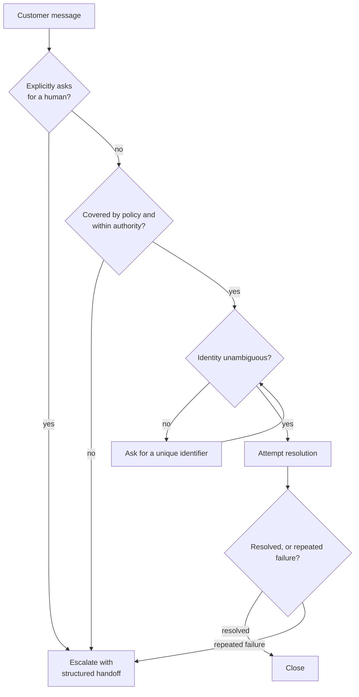

# CCAR-F Domain 5 – Context Management & Reliability (15%)

Nov 13, 2026 · Falaque Dani

Domain 5 is 15% of the exam, about 9 of 60 questions. It tests whether a Claude system stays correct over long runs: the right facts stay in context, the agent hands off to a human at the right moment, and failures and uncertainty are visible instead of hidden.

The questions sit mostly inside three scenarios: Customer Support Resolution Agent, Multi-Agent Research System and Structured Data Extraction. Each topic below has an explanation, a worked example and the exam traps for it. The last two sections collect every trap and the facts to memorize.

The rule of thumb this domain rewards is: **make it explicit and structured.** Keep facts in a structured block, set explicit escalation criteria, return structured error reports, use calibrated scores, and map every claim to its source. Answers that depend on the model "remembering", "noticing" or "feeling unsure" are usually the distractors.

Code examples use the Python `anthropic` SDK with `claude-opus-5-5`.

## 5.1 Context windows: why long runs degrade

A bigger context window does not mean better recall. Quality drops as context fills with noise, long before the window is full.

The context window is everything the model sees on one request: system prompt, tool definitions, every earlier message, every tool result and the new user turn. Current models such as Claude Opus 5.5 and Sonnet 5.5 accept up to 1M tokens. The Messages API is stateless, so your code resends the whole history on every call.

### Why quality degrades in long runs

| Cause | What happens | Typical fix |
| --- | --- | --- |
| Noise build-up | Verbose tool results (full API payloads, whole files) bury the few facts that matter | Trim tool output to the relevant fields |
| Lossy summaries | Summaries or compaction keep the gist but drop exact values (amounts, IDs, dates) | Keep a structured facts block outside the summary |
| Lost in the middle | Facts in the middle of a long context are recalled less reliably than facts at the start or end | Put key facts and instructions at the start or end |
| Stale results | Earlier tool output no longer matches reality (file edited, order updated) | Re-fetch, or tell the model what changed |
| Cost and latency | Every token is resent and billed on every turn | Prompt caching, trimming, compaction |

### Example

A support agent handles a 40-turn conversation. In turn 3 the customer says the order is #A-55821 and the refund owed is $142.50. By turn 35 the history holds 25 order-lookup results of about 3,000 tokens each, and the early turns have been summarized as "customer wants a refund for a damaged order". The agent now asks the customer for the order number again, or worse, guesses the amount. The model is fine; nobody preserved the facts.

### Exam traps

- "Switch to a model with a larger context window" rarely fixes forgotten facts. The fix is managing what goes into the context.
- "The model can see the whole conversation, so it will remember" is wrong: visible is not the same as reliably recalled.
- Context is per request. A subagent does not inherit the coordinator's context unless you pass it explicitly.

## 5.2 Preserving facts in long interactions

Critical facts should live in a structured block that your code owns and re-sends every turn, not in the model's memory of the conversation.

### The case-facts block

- Your application keeps a small structured record of the facts that must never drift: IDs, amounts, dates, verification status, promises made.
- Code updates it from tool results (e.g., after `lookup_order` returns), not from the model's prose.
- It is re-sent on every turn, near the end of the context, so it survives summarization and stays out of the "middle".
- The system prompt tells the model that the latest facts block wins over anything earlier.

```python
import json
import anthropic

client = anthropic.Anthropic()

SYSTEM = (
    "You are a support agent for Acme. The <case_facts> block in the latest "
    "user turn is the source of truth; trust it over earlier messages."
)

# Owned and updated by application code, never by the model
case_facts = {
    "customer_id": "C-10442",
    "order_id": "A-55821",
    "refund_owed_usd": 142.50,
    "identity_verified": True,
    "promises": ["replacement ships by 2026-11-15"],
}

messages = []

def ask(user_text: str) -> str:
    facts = f"<case_facts>\n{json.dumps(case_facts, indent=2)}\n</case_facts>"
    messages.append({"role": "user", "content": [
        {"type": "text", "text": facts},      # re-injected every turn
        {"type": "text", "text": user_text},
    ]})
    response = client.messages.create(
        model="claude-opus-5-5",
        max_tokens=16000,
        system=SYSTEM,
        messages=messages,
    )
    messages.append({"role": "assistant", "content": response.content})
    return "".join(b.text for b in response.content if b.type == "text")
```

The block is appended inside the new user turn, so the earlier history is unchanged and the prompt-cache prefix stays valid (see 5.3).

### Trimming tool output

A raw order API might return 40 fields and 3,000 tokens. The agent needs five. Trim before the result enters the context, and normalize formats while you are there.

```python
KEEP = ("order_id", "status", "total_usd", "items", "shipped_at")

def normalize_order(raw: dict) -> dict:
    slim = {k: raw[k] for k in KEEP if k in raw}
    if slim.get("shipped_at"):
        slim["shipped_at"] = slim["shipped_at"][:10]   # ISO date only
    return slim

# inside the agent loop, when building the tool_result block:
# {"type": "tool_result", "tool_use_id": block.id,
#  "content": json.dumps(normalize_order(raw_result))}
```

In the Claude Agent SDK or Claude Code, the same logic belongs in a `PostToolUse` hook or inside the tool / MCP server, so it runs on every call without relying on the prompt.

### Lost in the middle: placement rules

- Long documents and data go first; the question or task goes at the end.
- Standing instructions go in the system prompt; per-turn critical facts go in the latest turn.
- Do not bury a key constraint in paragraph 30 of a long tool result. Extract it into the facts block.

### Structured subagent results

Subagents should return compact, structured findings with metadata, not long prose. The coordinator can then merge, compare and cite them without re-reading everything.

```json
{
  "task": "EU battery regulation timeline",
  "status": "complete",
  "findings": [
    {"claim": "Battery passport required from Feb 2027",
     "source_url": "https://example.org/reg-2023-1542",
     "published": "2023-07-28",
     "confidence": "high"}
  ],
  "gaps": ["No primary source found for recycling targets after 2031"]
}
```

### Exam traps

- "Ask the model to summarize the conversation every 10 turns" loses exact values. Summaries are fine for gist, not for IDs and amounts.
- "Add 'remember the order number' to the system prompt" is a prompt-only fix for a data-management problem.
- Passing a subagent's full transcript back to the coordinator bloats its context. Return structured findings instead.

## 5.3 Prompt caching

Prompt caching reuses an identical prompt prefix across requests, so repeated context costs a fraction of the normal input price and returns faster.

### How it works

- The cache is a **prefix match**. The request is read in a fixed order: `tools` → `system` → `messages`. Any byte change in the prefix invalidates the cache from that point on.
- You mark the end of a cacheable prefix with `cache_control: {"type": "ephemeral"}` on a content block (a tool definition, a system text block, or a message block). Up to **4** breakpoints per request.
- Simplest option: a top-level `cache_control` on `messages.create()` caches up to the last cacheable block automatically.
- Prefixes below the model's minimum size are silently not cached (512 tokens on current models such as Opus 5.5; 1,024 to 4,096 on some older models).

### Pricing and lifetime

| Item | Value |
| --- | --- |
| Cache write, 5-minute TTL (default) | About 1.25× the base input price |
| Cache write, 1-hour TTL (`"ttl": "1h"`) | About 2× the base input price |
| Cache read | About 0.1× the base input price on most models (lower on some new models, e.g. 0.05× on Opus 5.5) |
| Lifetime refresh | Every cache hit resets the timer at no extra cost |
| Break-even | 5-minute: 2 requests; 1-hour: 3 requests |

Choose the TTL by the gap between requests: under 5 minutes, use the default; 5–60 minutes (a user who replies after 20 minutes), the 1-hour TTL pays off.

### Example: cache a large policy document and the tool list

```python
import anthropic

client = anthropic.Anthropic()

POLICY = open("refund_policy.md").read()   # ~20,000 tokens, never changes

tools = [
    {"name": "lookup_order", "description": "Get an order by ID.",
     "input_schema": {"type": "object",
                      "properties": {"order_id": {"type": "string"}},
                      "required": ["order_id"]}},
    {"name": "process_refund", "description": "Refund a verified order.",
     "input_schema": {"type": "object",
                      "properties": {"order_id": {"type": "string"},
                                     "amount_usd": {"type": "number"}},
                      "required": ["order_id", "amount_usd"]},
     "cache_control": {"type": "ephemeral"}},   # breakpoint 1: all tools
]

response = client.messages.create(
    model="claude-opus-5-5",
    max_tokens=16000,
    tools=tools,
    system=[
        {"type": "text", "text": "You are Acme's refund agent."},
        {"type": "text", "text": POLICY,
         "cache_control": {"type": "ephemeral"}},  # breakpoint 2: system
    ],
    messages=[{"role": "user", "content": "Where is my order A-55821?"}],
)

u = response.usage
print(u.cache_creation_input_tokens)  # written to cache this call
print(u.cache_read_input_tokens)      # served from cache (0 on first call)
print(u.input_tokens)                 # uncached input
```

If `cache_read_input_tokens` stays at 0 across repeated calls, something in the prefix changes each time: a timestamp in the system prompt, a random request ID, unsorted JSON, or a tool list that varies per request.

### Exam traps

- Putting `datetime.now()` or a user name at the top of the system prompt breaks caching for everything after it. Put changing content last.
- Caching does not change what the model sees or how it answers; it only cuts cost and latency.
- Changing the tool list invalidates the system and messages cache too, because tools come first in the prefix.
- The 1-hour TTL is not "always better": its write costs 2×, so it only pays off for gaps longer than 5 minutes.

## 5.4 Compaction and context editing

Compaction summarizes old context; context editing deletes old tool results or thinking. Both free space, and both lose detail, which is why critical facts go in a separate block.

| Technique | What it does | Where |
| --- | --- | --- |
| `/compact` | Summarizes the conversation so far and continues from the summary; you can add focus instructions (e.g. `/compact keep the database schema decisions`) | Claude Code |
| Auto-compact | Claude Code compacts automatically as the context nears its limit | Claude Code |
| `/clear` | Wipes the conversation; start fresh for an unrelated task | Claude Code |
| Server-side compaction (beta) | The API summarizes earlier context when input reaches a trigger (default 150K tokens) and returns a `compaction` block | Messages API |
| Context editing (beta) | Clears old tool results (`clear_tool_uses_20250919`) or thinking blocks (`clear_thinking_20251015`) before the model sees them | Messages API |

### Example: server-side compaction

```python
import anthropic

client = anthropic.Anthropic()
messages = []

def chat(user_message: str) -> str:
    messages.append({"role": "user", "content": user_message})
    response = client.beta.messages.create(
        betas=["compact-2026-01-12"],
        model="claude-opus-5-5",
        max_tokens=16000,
        messages=messages,
        context_management={"edits": [{"type": "compact_20260112"}]},
    )
    # Append the FULL content: the compaction block must be sent back
    messages.append({"role": "assistant", "content": response.content})
    return next(b.text for b in response.content if b.type == "text")
```

The most common bug: appending only the text string instead of `response.content`. The compaction block is then lost and the history is never replaced.

### When to use which

- Long exploratory session in Claude Code that is still on the same task → `/compact` with focus instructions.
- Switching to an unrelated task → `/clear`.
- Agent loop where old tool results are no longer needed (e.g., 50 file reads) → context editing to clear them.
- Very long API conversations → server-side compaction, plus a case-facts block for exact values.

### Exam traps

- Compaction is lossy. "Compact more often" does not fix a lost order number; a structured facts block does.
- `/clear` mid-task throws away the working context. Use it between tasks, not to fix a slow session that still needs its history.
- Write important findings to a notes file before compacting, so they survive (see 5.7).

## 5.5 Escalation design

Escalate on explicit, written criteria, and hand the human a structured summary. Do not rely on the model's sense of confidence or on customer sentiment alone.

### Escalation criteria

| Trigger | Action |
| --- | --- |
| Customer explicitly asks for a human | Escalate immediately. Do not try to resolve or retain first |
| Policy does not cover the case (a gap) | Escalate. Do not invent a policy |
| Action exceeds the agent's authority (e.g., refund above $500) | Escalate; enforce the limit in code, not just in the prompt |
| Repeated failure (e.g., 2 failed resolution attempts) | Escalate with what was tried |
| Legal threat, safety issue, suspected fraud | Escalate at once |
| Ambiguous identity (several matching records) | Do NOT escalate or guess: ask for a unique identifier |



The explicit-human and policy checks come before any attempt to resolve; ambiguity loops back through a question, not a guess.

### Why not "escalate when unsure"?

- A model's self-reported confidence is poorly calibrated: it can be confidently wrong, and "unsure" on easy cases.
- Sentiment is a weak trigger: an angry customer with a simple tracking question can be served; a calm customer asking for something outside policy needs a human.
- Explicit criteria are testable and auditable. You can count how often each fired.

### Example: escalation policy in the system prompt, limit in code

```python
SYSTEM = """You are Acme's support agent.
Escalate with escalate_to_human when ANY of these is true:
1. The customer asks for a human, manager or agent. Escalate at once.
2. The request is not covered by the refund policy below.
3. A refund above $500 is needed.
4. You have tried to resolve the issue twice without success.
5. The customer mentions legal action, injury or fraud.
If a search returns more than one customer, ask for the email or order
number. Never guess which record is right."""

REFUND_LIMIT_USD = 500

def run_tool(name: str, args: dict) -> dict:
    # Deterministic gate: the prompt alone is not enough
    if name == "process_refund" and args["amount_usd"] > REFUND_LIMIT_USD:
        return {"is_error": True,
                "error": "Refund exceeds agent limit; escalate_to_human."}
    return TOOLS[name](**args)
```

### Structured handoff

The human agent cannot read the transcript quickly. Give them everything needed to act without asking the customer to repeat anything.

```json
{
  "customer_id": "C-10442",
  "order_id": "A-55821",
  "reason": "refund_above_limit",
  "summary": "Laptop arrived with cracked screen; customer wants full refund.",
  "amount_requested_usd": 1249.00,
  "identity_verified": true,
  "actions_taken": ["Verified identity", "Confirmed damage photos received"],
  "customer_sentiment": "frustrated",
  "recommended_action": "Approve refund or offer replacement",
  "promises_made": []
}
```

### Exam traps

- "Try to resolve it first, then escalate if the customer insists again" is wrong when the customer has already asked for a human.
- "Escalate when the model's confidence is below 0.7" relies on poorly calibrated self-assessment.
- When two customers match, picking the most recent one is a guess. Ask for an identifier.
- A handoff that says only "customer needs help with refund" forces the human to start over.

## 5.6 Error propagation in multi-agent systems

A failure in one subagent must reach the coordinator with enough context to decide what to do. Then the final output must say what is missing.

### The two wrong extremes

| Wrong extreme | Why it fails |
| --- | --- |
| Silent suppression: the subagent returns an empty list or "no results" as if it succeeded | The coordinator concludes "nothing exists" and the final report is confidently wrong |
| Total abort: one failed subagent stops the whole workflow | Nine good results are thrown away because of one timeout |

The right middle: retry transient errors locally, report unrecoverable ones up with context, continue with what succeeded, and annotate the gaps.

### What a subagent error report contains

- **What failed:** the task and the specific operation (e.g., "fetch court records API").
- **Error type:** transient (timeout, rate limit), permission, validation, not found.
- **What was tried:** retries done, alternative sources attempted.
- **Partial results:** anything that did succeed.
- **Impact:** which part of the overall task is now uncovered.

```python
def research_subagent(topic: str) -> dict:
    results, errors = [], []
    for source in SOURCES[topic]:
        try:
            results.extend(fetch_with_retry(source, attempts=3))
        except TimeoutError:
            errors.append({"source": source, "type": "transient",
                           "tried": "3 retries with backoff"})
        except PermissionError:
            errors.append({"source": source, "type": "permission",
                           "tried": "no retry (not retryable)"})
    return {
        "topic": topic,
        "status": "partial" if errors else "complete",
        "results": results,          # keep what succeeded
        "errors": errors,            # never hide what failed
    }
```

### Coverage annotations in the final output

The coordinator passes gaps through to the user instead of smoothing them over:

> **Coverage note:** Financial filings for 2025 could not be retrieved (source returned 403 after 3 attempts). Section 3 is based on 2024 filings only.

### Access failure vs empty result

These must look different to the agent. "The database timed out" and "the customer has no orders" lead to opposite actions. Return a structured error (`is_error: true` plus a category) for the first and a valid empty result for the second.

### Exam traps

- Catching every exception and returning `[]` looks robust but hides failures. It is the classic wrong answer.
- "Fail the whole pipeline on any subagent error" is the opposite wrong extreme.
- Retrying a permission error is pointless; retry only transient errors.

## 5.7 Exploring large codebases

Exploration fills context fastest of all. Keep the main session lean: delegate searching to subagents, and write findings and progress to files that outlive the context.

### Three techniques

| Technique | What it solves | How |
| --- | --- | --- |
| Exploration subagents (e.g., Explore) | Hundreds of file reads flooding the main context | The subagent searches in its own context and returns a short summary of what it found and where |
| Scratchpad / notes file | Findings lost to compaction or a new session | Write key findings to a file (e.g., `NOTES.md`) as you go; re-read it after `/compact` or in a new session |
| Manifest / progress file | A crash or context reset halfway through a long, multi-step job | Keep a checklist of items done and pending; on restart, read it and continue from the first pending item |

### Example: a migration across 300 files

Task: replace a deprecated logging call in 300 files.

1. A subagent finds all call sites with Grep and writes the list to `migration_manifest.json`.
2. The main agent processes files in batches and marks each one done in the manifest after its tests pass.
3. Important decisions ("use `logger.warning`, not `logger.warn`") go in `NOTES.md`.
4. If the session crashes at file 180, a new session reads the manifest and notes, then resumes at file 181. Nothing is redone or forgotten.

```json
{
  "task": "replace log.warn with logger.warning",
  "files": [
    {"path": "billing/invoice.py", "status": "done"},
    {"path": "billing/refund.py",  "status": "done"},
    {"path": "orders/api.py",      "status": "pending"}
  ],
  "decisions": ["Keep log levels unchanged", "Skip vendored code in third_party/"]
}
```

### Exam traps

- "Read the whole repository into context first" wastes context and degrades quality. Search, then read what matters.
- Relying on the conversation as the only record of progress fails at the first crash or compaction. Use a manifest file.
- Resuming a session whose earlier file reads are now stale (files changed since) can mislead the agent. Re-read, or start fresh with the notes file.

## 5.8 Human review and confidence calibration

A single overall accuracy number can hide a weak segment. Measure accuracy per segment, use field-level scores checked against labelled data, and route only the risky items to people.

### Key ideas

- **Stratified sampling:** sample separately from each document type or field, so small but risky segments get enough samples to measure.
- **Field-level confidence:** score each extracted field, not the whole document. One bad total in an otherwise perfect invoice matters.
- **Calibration:** a score is calibrated when items scored 0.9 are right about 90% of the time. Check this on a labelled validation set before trusting any threshold.
- **Routing threshold:** auto-accept above the threshold, send the rest to human review. Pick the threshold from the calibration data and the accuracy target.
- **Drift sampling:** keep auditing a small random share of auto-accepted items, so you notice when inputs change.

### Worked example: invoice extraction, 10,000 documents a month

The team reports 97% field accuracy and wants to remove human review. Stratifying by document type tells a different story:

| Document type | Share of volume | Field accuracy |
| --- | --- | --- |
| Standard PDF invoices | 80% (8,000) | 99% |
| Handwritten receipts | 15% (1,500) | 91% |
| Foreign-currency invoices | 5% (500) | 82% |
| **Weighted overall** | 100% | **97%** (0.80×99 + 0.15×91 + 0.05×82) |

A random sample of 200 documents would hold only about 10 foreign-currency invoices, too few to see the 82%. A stratified sample (e.g., 100 per type) exposes it.

Next, calibrate the field scores on 2,000 labelled fields:

| Score band | Share of fields | Actual accuracy |
| --- | --- | --- |
| 0.90–1.00 | 78% | 99.4% |
| 0.70–0.89 | 16% | 94% |
| Below 0.70 | 6% | 80% |
| **Overall** | 100% | **97%** (matches the reported figure) |

With an accuracy target of 98% for auto-accepted data, set the threshold at 0.90: 78% of fields flow through automatically at 99.4%, and the other 22% go to reviewers. A threshold of 0.70 would let 94% of fields through but at only about 98.4%, too close to the target to be safe. Then audit, say, 2% of the auto-accepted fields every week to catch drift.

### Exam traps

- "97% overall, so remove human review" ignores the weak segment. Stratify first.
- Using the model's raw self-reported confidence without checking it against labelled data is not calibration.
- Sending everything to humans wastes reviewer time; sending nothing hides errors. Route by calibrated threshold.
- Stopping all sampling of high-confidence items means drift goes unnoticed.

## 5.9 Information provenance in synthesis

Every claim in a synthesized report should trace back to a source, and conflicts between sources should be shown, not silently resolved.

### Rules

- **Claim → source mapping end to end.** Subagents return each finding with its source URL or document, a short supporting quote and a publication date. The coordinator keeps that mapping when it merges results. Provenance dropped at the subagent stage cannot be recovered later.
- **Conflicting sources:** report both values with their sources and dates, and say they disagree. Do not average them or quietly pick one.
- **Publication dates** tell an outdated figure from a genuine contradiction. A 2021 estimate vs a 2025 measurement is an update, not a dispute.
- **Unsupported claims** are marked as such, or removed.

### Example output structure

```json
{
  "question": "What share of EU new car sales were battery-electric in 2025?",
  "claims": [
    {
      "claim": "Battery-electric cars were about 17% of EU new car sales in 2025.",
      "sources": [
        {"title": "Industry association annual report",
         "url": "https://example.org/annual-report-2025",
         "published": "2026-01-22",
         "quote": "BEVs accounted for 17.1% of registrations"}
      ]
    }
  ],
  "conflicts": [
    {
      "topic": "2025 BEV share",
      "values": [
        {"value": "17.1%", "source": "Industry association", "published": "2026-01-22"},
        {"value": "15.8%", "source": "Analyst forecast", "published": "2025-03-10"}
      ],
      "note": "Forecast predates the full-year data; the later figure is likely current."
    }
  ]
}
```

(The figures above are invented to show the structure.)

### Exam traps

- "Use the most authoritative source and drop the other" hides a real disagreement from the reader.
- Asking the coordinator to "add citations at the end" fails if subagents never returned sources.
- A claim with no date can be stale; dates let the reader judge recency.

## Exam traps: consolidated

If an option fixes a data, reliability or routing problem with a prompt tweak, a bigger model or blind trust in the model, it is usually the distractor.

| Tempting wrong answer | Correct instead | Topic |
| --- | --- | --- |
| Use a model with a larger context window so it remembers | Manage context: facts block, trimming, placement | 5.1 |
| Summarize the conversation periodically to keep facts | Structured case-facts block re-sent every turn; summaries lose exact values | 5.2 |
| Pass the subagent's full transcript to the coordinator | Structured findings with source, date and confidence | 5.2 |
| Put the current time or user name at the top of the system prompt | Stable content first; changing content after the last cache breakpoint | 5.3 |
| Always use the 1-hour cache TTL | 5-minute TTL for gaps under 5 minutes; 1-hour only for 5–60 minute gaps | 5.3 |
| Compact more often to stop forgetting | Compaction is lossy; keep exact values in a facts block or notes file | 5.4 |
| Try to resolve first when the customer asks for a human | Escalate immediately with a structured handoff | 5.5 |
| Escalate when the model reports low confidence or the customer sounds angry | Explicit, written escalation criteria | 5.5 |
| Pick the most likely record when several customers match | Ask for a unique identifier | 5.5 |
| Rely on the prompt to stop refunds above the limit | Enforce the limit in code (gate or hook) and escalate | 5.5 |
| Catch all errors and return an empty list | Structured error with type, what was tried and partial results | 5.6 |
| Abort the whole workflow when one subagent fails | Continue with what succeeded; annotate coverage gaps | 5.6 |
| Read the entire repository into context | Exploration subagents; read only what matters | 5.7 |
| Track progress only in the conversation | Manifest / progress file and notes file for resumption | 5.7 |
| 97% overall accuracy, so remove human review | Stratified sampling per segment; calibrated field-level thresholds | 5.8 |
| Pick the most authoritative source when two disagree | Show both values with sources and dates | 5.9 |

## Key facts to memorize

- **Prompt cache order:** `tools` → `system` → `messages`; any byte change invalidates everything after it.
- **Cache breakpoints:** `cache_control: {"type": "ephemeral"}`, up to 4 per request; `"ttl": "1h"` for the 1-hour option.
- **Cache prices:** write about 1.25× (5 min) or 2× (1 h); read about 0.1× on most models; every hit refreshes the timer.
- **Verify caching:** `usage.cache_creation_input_tokens` and `usage.cache_read_input_tokens`.
- **Server-side compaction:** beta `compact-2026-01-12`, default trigger 150K tokens; append the full `response.content`.
- **Context editing:** beta; `clear_tool_uses_20250919` clears old tool results, `clear_thinking_20251015` clears thinking.
- **Claude Code:** `/compact [focus]` summarizes; `/clear` resets; auto-compact near the limit.
- **Case-facts block:** owned by code, updated from tool results, re-sent every turn near the end of the context.
- **Lost in the middle:** key facts at the start or end; long documents first, question last.
- **Escalation triggers:** explicit human request (immediately), policy gap, authority limit, repeated failure, legal/safety/fraud. Ambiguous identity → ask for an identifier.
- **Not escalation triggers on their own:** model self-confidence, sentiment.
- **Error report fields:** what failed, error type, what was tried, partial results, impact.
- **Two wrong extremes:** silent suppression and total abort.
- **Long jobs:** exploration subagents, notes file, manifest / progress file.
- **Calibration:** score 0.9 should mean about 90% correct on labelled data; stratify by segment; keep drift sampling.
- **Provenance:** claim + source + quote + date from the subagent onward; show conflicts with both sources.
