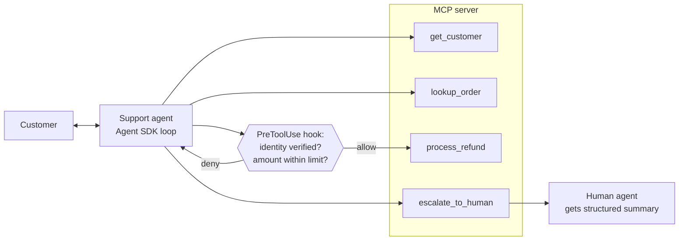
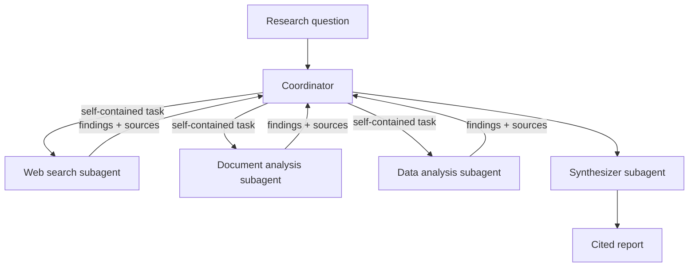

# CCAR-F – The Six Exam Scenarios

Nov 13, 2026 · Falaque Dani

## How scenarios work

Each exam sitting draws 4 of these 6 scenarios at random, and every question sits inside one of them. Prepare all six: you cannot predict which four you get.

A scenario opens with a short setup (the company, the system, the tools, a constraint). Several questions then reuse that setup, each describing a symptom or a design choice. Read the setup once, carefully, and note three things:

1. **The tools and components named.** The correct answer almost always works with what the setup already has.
2. **The hard constraint.** Words like *must*, *always*, *compliance*, *cheapest*, *within seconds* decide between two plausible options.
3. **Who is affected.** One developer, the whole team, end customers, or a pipeline. This decides where config lives and how strict the fix must be.

The exam rewards the same instincts across all six scenarios:

- Enforce must-hold rules in code (hooks, gates, schemas, forced `tool_choice`), not in prompt wording.
- Fix the root cause in the place it lives (tool description, CLAUDE.md level, schema), not a symptom elsewhere.
- Prefer the smallest change that works over new agents, new models or fine-tuning.
- Make failure and uncertainty visible (structured errors, coverage notes, human review), never silent.

Source note: scenario names and their domain mix follow third-party prep sites; Anthropic does not publish the exam guide openly. Domain names below use the short form: Agentic, Claude Code, Prompt, Tool/MCP, Context.

## Scenario 1: Customer Support Resolution Agent

The support agent must resolve requests end to end, but refunds and escalations follow hard business rules that only code can guarantee.

**Likely setup:** a retailer runs a Claude agent (Agent SDK) that talks to customers. It has four MCP tools: `get_customer` (verify identity, fetch profile), `lookup_order`, `process_refund`, and `escalate_to_human`. Policy: refunds only after identity is verified, and only up to a set amount; anything above goes to a human.

**Domains:** Agentic (loop, enforcement, handoff), Tool/MCP (descriptions, errors), Context (long chats, escalation).

### Reference architecture



Every tool call goes to the MCP server, but `process_refund` must first pass the hook; escalations reach a human with a structured summary.

### Key design decisions

- **Identity gate in code.** A `PreToolUse` hook denies `process_refund` until `get_customer` has verified this customer in this session.
- **Refund limit in code.** The same hook (or the refund tool itself) rejects amounts above the limit and points the agent to `escalate_to_human`.
- **Structured handoff.** `escalate_to_human` takes a schema: customer ID, order ID, issue, steps tried, current state, recommended action. The human never sees the transcript.
- **Case facts block.** Order number, amount and promises live in a structured block re-sent each turn, so summarization cannot lose them.
- **Clear tool descriptions.** `lookup_order` says it needs an order ID or customer ID, and what it returns when nothing matches.

### Example: refund identity gate

```python
from claude_agent_sdk import ClaudeAgentOptions, HookMatcher

verified: set[str] = set()   # customer IDs verified this session
REFUND_LIMIT = 200.00

async def record_verification(input_data, tool_use_id, context):
    # PostToolUse on get_customer: remember who was verified
    resp = input_data.get("tool_response") or {}
    if isinstance(resp, dict) and resp.get("verified"):
        verified.add(input_data["tool_input"]["customer_id"])
    return {}

async def gate_refund(input_data, tool_use_id, context):
    args = input_data["tool_input"]
    if args["customer_id"] not in verified:
        reason = "Verify identity with get_customer before any refund."
    elif args["amount"] > REFUND_LIMIT:
        reason = f"Refunds over {REFUND_LIMIT} need escalate_to_human."
    else:
        return {}
    return {"hookSpecificOutput": {
        "hookEventName": "PreToolUse",
        "permissionDecision": "deny",
        "permissionDecisionReason": reason,
    }}

options = ClaudeAgentOptions(
    hooks={
        "PostToolUse": [HookMatcher(matcher="mcp__support__get_customer", hooks=[record_verification])],
        "PreToolUse": [HookMatcher(matcher="mcp__support__process_refund", hooks=[gate_refund])],
    },
)
```

The deny reason goes back to Claude, so it can recover (ask for identity, or escalate) instead of failing.

### Typical failures and fixes

| Symptom | Expected fix | Why the tempting option is wrong |
| --- | --- | --- |
| Agent sometimes refunds before verifying identity | `PreToolUse` gate (above) | "Add 'always verify first' to the system prompt" still fails some percentage of the time |
| Customer says "let me talk to a person"; agent keeps troubleshooting | Escalate immediately when a human is explicitly requested | "Try to resolve first to cut costs" ignores an explicit request and frustrates the customer |
| Human agent re-asks everything after handoff | Structured handoff schema in `escalate_to_human` | "Attach the full transcript" is long and buries the key facts |
| Refund amount drifts after a 40-turn chat | Case facts block re-sent each turn | "Use a bigger context window" does not stop summaries losing exact numbers |
| "No orders found" when the order DB actually timed out | Structured error: `isError`, category, `isRetryable` | Returning `[]` makes a failure look like a real empty result |
| Two customers match "J. Smith" | Ask for a unique identifier (email, order ID) | Picking the most recent account risks acting on the wrong person |

### Mini-questions

**Q1.** Audits show 3% of refunds happen without identity verification, despite a clear system prompt rule. What is the best fix? A) Repeat the rule at the end of the prompt. B) Add few-shot examples of verification. C) Add a `PreToolUse` hook that blocks `process_refund` until verification is recorded. D) Switch to a larger model.

**Answer: C.** The rule must always hold, so it belongs in deterministic code. A, B and D all improve odds but cannot guarantee it.

**Q2.** A customer writes "I want a human, now" in the first message. The issue looks easy. What should the agent do? A) Resolve it quickly, then offer a human. B) Escalate immediately with a structured summary. C) Ask why they want a human. D) Check sentiment first.

**Answer: B.** An explicit request for a human is an escalation trigger by itself. The handoff still carries the case facts so the human starts informed.

## Scenario 2: Code Generation with Claude Code

This scenario is about putting the right instruction in the right place, so Claude Code writes code that follows the team's conventions every time.

**Likely setup:** a team of developers uses Claude Code in a shared repository (e.g., a Python backend plus a React frontend). Generated code sometimes ignores conventions, large changes go wrong, and developers repeat the same multi-step prompts.

**Domains:** Claude Code (CLAUDE.md, rules, commands, skills, plan mode), Context (long sessions, exploration).

### Reference architecture

| Layer | Lives in | Holds |
| --- | --- | --- |
| Team standing rules | `./CLAUDE.md` (committed) | Build/test commands, architecture, style |
| Folder-specific rules | `frontend/CLAUDE.md` | Rules for one directory |
| Cross-cutting rules | `.claude/rules/tests.md` with `paths:` glob | Rules for all files of a type |
| Personal preferences | `~/.claude/CLAUDE.md` | One developer's habits only |
| Repeatable workflows | `.claude/commands/` or `.claude/skills/` | Multi-step procedures, loaded on demand |
| Guardrails | `.claude/settings.json` (hooks, permissions) | Formatter after each edit, blocked commands |

### Key design decisions

- Team conventions go in the **project** CLAUDE.md, committed to git, never in a personal file.
- Rules for a file type spread across folders (all `*.test.py`) go in `.claude/rules/` with a `paths:` glob.
- Long procedures (release steps, migration recipe) go in a skill, not CLAUDE.md, so they load only when needed.
- Big or unclear changes start in **plan mode**; small, clear edits run directly.
- Things that must always happen (format, lint) run as hooks, not as a CLAUDE.md request.

### Example: path-specific rule

```markdown
---
paths:
  - "**/*.test.py"
  - "tests/**"
---
# Test conventions
- Use pytest fixtures, never unittest.TestCase.
- One behaviour per test; name tests test_<unit>_<behaviour>.
- Mock network calls with respx; no real HTTP in tests.
```

Saved as `.claude/rules/testing.md`, this loads only when Claude works on matching files.

### Example: formatter hook in settings.json

```json
{
  "hooks": {
    "PostToolUse": [
      {
        "matcher": "Edit|Write",
        "hooks": [{ "type": "command", "command": "ruff format ." }]
      }
    ]
  }
}
```

### Typical failures and fixes

| Symptom | Expected fix | Why the tempting option is wrong |
| --- | --- | --- |
| New hire's Claude ignores conventions that work for a senior dev | Move rules from `~/.claude/CLAUDE.md` to project `CLAUDE.md` | "Tell the new hire to copy the file" is fragile and drifts |
| Test conventions ignored in tests scattered across folders | `.claude/rules/` file with `paths:` glob | A CLAUDE.md in every folder duplicates rules |
| CLAUDE.md is 2,000 lines and Claude misses rules | Split: `@imports`, rules files, move procedures into skills | "Put critical rules in capitals" does not fix overload |
| 30-file refactor goes off track halfway | Plan mode first, review the plan, then execute | Direct execution on a large, unclear change wastes work |
| Code often left unformatted | `PostToolUse` hook running the formatter | A CLAUDE.md line "always format" is not guaranteed |
| Developers retype the same 6-step prompt | Project slash command or skill in `.claude/` | Pasting from a wiki is slow and inconsistent |

### Mini-questions

**Q1.** A rule "use the repository pattern for DB access" works for one developer but not teammates. Where is it most likely defined, and what is the fix? A) In `.claude/settings.json`; move it to CLAUDE.md. B) In `~/.claude/CLAUDE.md`; move it to the project `CLAUDE.md`. C) In a skill; make it a slash command. D) In `.mcp.json`; move it to user scope.

**Answer: B.** User-level memory applies to one person only. Team rules belong in the committed project file.

**Q2.** The team wants every test file, wherever it lives, to follow the same rules, without loading them for other work. Best option? A) Root CLAUDE.md. B) A CLAUDE.md in each test folder. C) `.claude/rules/testing.md` with a `paths:` glob. D) A `PreToolUse` hook.

**Answer: C.** Path-scoped rules load only for matching files and avoid duplication. A loads them always; B duplicates; D is for enforcement, not guidance.

## Scenario 3: Multi-Agent Research System

A coordinator splits a research question across isolated subagents, so success depends on what it passes them, how failures surface, and how sources are kept.

**Likely setup:** an analyst team uses a coordinator agent that splits a research question (e.g., "market outlook for battery recycling in the EU") across subagents: web search, document analysis, data analysis, and a synthesizer that writes a cited report.

**Domains:** Agentic (coordinator–subagent, spawning, decomposition), Tool/MCP (tool scoping, errors), Context (error propagation, provenance).

### Reference architecture



All traffic runs through the coordinator: it sends each subagent a self-contained task and gets back structured findings with sources, which the synthesizer turns into a cited report.

### Key design decisions

- **Explicit context passing.** Subagents see only their own prompt. The coordinator passes the goal, the sub-question, scope limits (dates, regions) and the output format.
- **Dynamic selection.** The coordinator picks which subagents a query needs; it does not run all of them every time.
- **Parallel spawning.** Independent sub-questions go out as several Task calls in one response.
- **Structured returns.** Each finding comes back with claim, source URL, quote, publication date and confidence, so provenance survives synthesis.
- **Scoped tools.** Researchers get search and fetch; only the synthesizer writes the report file.
- **Failures annotated.** If one source or subagent fails, the report continues and states the gap.

### Example: subagent definitions (Agent SDK)

```python
from claude_agent_sdk import ClaudeAgentOptions, AgentDefinition

options = ClaudeAgentOptions(
    # The coordinator must be allowed to call the Task tool to delegate
    allowed_tools=["Task", "Read", "Write"],
    agents={
        "web-researcher": AgentDefinition(
            description="Use to research ONE sub-question from public web sources.",
            prompt=(
                "Answer only the sub-question you are given. Return a JSON list of "
                "findings: claim, source_url, quote, published_date, confidence. "
                "If a source fails, report it in a 'gaps' list; never invent data."
            ),
            tools=["WebSearch", "WebFetch"],
            model="sonnet",
        ),
        "synthesizer": AgentDefinition(
            description="Use last, to merge findings into a cited report.",
            prompt=(
                "Write the report from the findings provided. Cite every claim. "
                "When sources conflict, show both with dates. List coverage gaps."
            ),
            tools=["Read", "Write"],
            model="opus",
        ),
    },
)
```

### Typical failures and fixes

| Symptom | Expected fix | Why the tempting option is wrong |
| --- | --- | --- |
| Subagent researches the wrong region or period | Coordinator passes scope and constraints explicitly in the Task prompt | "The subagent can read the conversation" is false: contexts are isolated |
| Every query runs all four subagents; cost is high | Coordinator selects subagents per query | "Use a cheaper model everywhere" hides the real waste |
| One API outage makes the whole report fail | Continue with what succeeded; annotate the gap | Aborting everything, or silently dropping the section, both lose information |
| Report states a figure with no traceable source | Findings carry claim–source–quote–date through to the synthesizer | "Ask the synthesizer to add citations at the end" invites made-up citations |
| Two sources give different market sizes | Report both with sources and publication dates | Picking one (newest or largest) hides a real disagreement |
| Coordinator context fills with raw page text | Subagents return condensed, structured findings | Raising the context limit only delays the problem |

### Mini-questions

**Q1.** A research subagent returns results about the US when the user asked about the EU. The coordinator's own conversation clearly mentions the EU. Most likely cause? A) The model ignored instructions. B) The coordinator did not include the EU scope in the subagent's prompt. C) The subagent's tool list is too short. D) Temperature is too high.

**Answer: B.** Subagents do not inherit the coordinator's conversation. Anything they need must be passed explicitly.

**Q2.** One of five data sources times out. What should the final report do? A) Fail and ask the user to retry. B) Omit the topic silently. C) Publish with the other sources and state that source X was unavailable and which sections may be incomplete. D) Fill in from the model's background knowledge.

**Answer: C.** Partial results plus clear coverage notes keep the report useful and honest. D risks unsourced claims.

## Scenario 4: Developer Productivity with Claude

This scenario tests picking the right built-in tool, connecting team systems through MCP the right way, and exploring large codebases without drowning the context.

**Likely setup:** engineers use Claude Code (and possibly custom Agent SDK tools) to explore an unfamiliar monorepo, find where things are used, make edits, and pull data from GitHub, Jira or an internal API through MCP servers.

**Domains:** Tool/MCP (built-in tools, MCP config, descriptions), Claude Code (subagents, plan mode), Agentic (delegation).

### Reference architecture

| Need | Right tool or mechanism |
| --- | --- |
| Find files by name or pattern | Glob (`**/*.proto`) |
| Find where code is used | Grep (regex over contents) |
| Understand a file | Read |
| Change a unique snippet | Edit (`old_string` must be unique) |
| Rewrite or create a file | Write (after Read for existing files) |
| Run tests, builds, git | Bash |
| Broad read-only exploration | Explore subagent, returns a summary |
| Team-shared integration (GitHub, Jira) | MCP server in project `.mcp.json` |
| Personal integration | MCP server at user or local scope |

### Key design decisions

- **Glob for names, Grep for contents.** Both are faster and safer than `find`/`grep` through Bash.
- **Edit needs a unique anchor.** If the text appears twice, add surrounding lines, or Read then Write the whole file.
- **Delegate exploration.** A subagent searches and returns a summary, keeping the main context clean.
- **Shared MCP config, private secrets.** Project `.mcp.json` is committed; tokens come from environment variables.
- **Use existing MCP servers** for standard systems before writing custom ones.
- **Clear tool descriptions** when adding custom tools, so Claude chooses the right one.

### Example: project .mcp.json

```json
{
  "mcpServers": {
    "github": {
      "type": "http",
      "url": "https://api.githubcopilot.com/mcp/",
      "headers": { "Authorization": "Bearer ${GITHUB_TOKEN}" }
    },
    "jira": {
      "type": "stdio",
      "command": "npx",
      "args": ["-y", "@acme/jira-mcp"],
      "env": { "JIRA_API_TOKEN": "${JIRA_API_TOKEN}" }
    }
  }
}
```

Committed at the repo root, every teammate gets the same servers; each supplies their own token through the environment. (The Jira package name is illustrative.)

### Typical failures and fixes

| Symptom | Expected fix | Why the tempting option is wrong |
| --- | --- | --- |
| Edit fails: "old\_string is not unique" | Include more surrounding context, or Read + Write | Retrying the same Edit fails the same way |
| Claude uses Bash `find` and `grep`, output is noisy | Use Glob and Grep built-ins | Bash works but is slower and harder to permission |
| Main session context fills while mapping the repo | Delegate to an Explore subagent; save findings to a notes file | `/clear` throws away what was learned |
| GitHub MCP works for one dev, not the team | Move it to project `.mcp.json` | Asking everyone to run `claude mcp add` drifts |
| API token committed in `.mcp.json` | Use `${ENV_VAR}` expansion | Making the repo private does not fix a leaked secret |
| Claude calls `search_code` when `find_symbol` was right | Sharpen both tool descriptions with when/when-not | Adding a system prompt line is a weaker, indirect fix |

### Mini-questions

**Q1.** A developer asks Claude to find every place `calculate_tax(` is called across the monorepo. Best tool? A) Glob. B) Grep. C) Read every file. D) WebSearch.

**Answer: B.** Grep searches file contents. Glob matches file names only.

**Q2.** The team wants a shared Jira MCP server, but each developer has their own API token. Best setup? A) User-scope server with the token inline. B) Project `.mcp.json` with the token hard-coded. C) Project `.mcp.json` using `${JIRA_API_TOKEN}`, each developer setting the variable. D) Each developer builds their own server.

**Answer: C.** Shared config, private secrets. B leaks credentials; A and D don't share config.

## Scenario 5: Claude Code for CI/CD

In a pipeline nobody is watching, so Claude Code must run headless, produce output a script can parse, stay within tight permissions, and review independently.

**Likely setup:** a team runs Claude Code in GitHub Actions (or another CI system) to review pull requests, suggest fixes or triage failures. Output feeds PR comments or a pass/fail gate. Complaints: noisy false positives, unparseable output, duplicate comments on every push, and reviews that approve the bot's own code.

**Domains:** Claude Code (headless mode, CLAUDE.md as review standard, CI integration), Prompt (explicit criteria, structured output, multi-pass review, batch vs real-time).

### Reference architecture

1. PR opened or updated triggers the workflow.
2. The job checks out the repo; the project `CLAUDE.md` supplies review standards.
3. `claude -p` runs headless with read-only tools and a turn cap.
4. Output is JSON matching a schema; a script posts comments and sets the check status.
5. On later pushes, earlier findings are passed in so only new issues are reported.

### Key design decisions

- **Headless:** `claude -p "<prompt>"` runs once and exits; no interactive session.
- **Machine-readable output:** `--output-format json` plus `--json-schema` so the pipeline parses results reliably.
- **Least privilege:** `--allowedTools` limited to Read, Grep, Glob (no Write, no Bash) for a reviewer; `--max-turns` caps runtime and cost.
- **Explicit review criteria** in CLAUDE.md or the prompt: what to flag, what not to flag, severity definitions with examples.
- **Independent reviewer:** code written by one Claude session is reviewed by a separate session that never saw the generation reasoning.
- **Large PRs:** a per-file pass for local issues, then a cross-file pass for integration issues.
- **Real-time, not batch:** a check that blocks merging cannot wait up to 24 hours for the Batches API.

### Example: GitHub Actions review step

```yaml
- name: Claude review
  env:
    ANTHROPIC_API_KEY: ${{ secrets.ANTHROPIC_API_KEY }}
  run: |
    claude -p "Review the diff in pr.diff against CLAUDE.md standards.
      Report only issues in categories: security, correctness, data-loss.
      Skip style. Ignore issues listed in previous_findings.json." \
      --output-format json \
      --json-schema "$(cat .github/review-schema.json)" \
      --allowedTools "Read,Grep,Glob" \
      --max-turns 15 > review.json
    python .github/post_review.py review.json
```

The schema (`review-schema.json`) might require a `findings` array of `{file, line, category, severity, message}` with `category` as an enum.

### Typical failures and fixes

| Symptom | Expected fix | Why the tempting option is wrong |
| --- | --- | --- |
| Pipeline crashes parsing free-text output | `--output-format json` with `--json-schema` | Regex-parsing prose breaks on the next wording change |
| Many false positives; developers ignore the bot | Explicit categories of what to flag and not flag, with severity examples | "Only report high-confidence issues" is vague and barely helps |
| Same comments reposted on every push | Pass earlier findings in; report only new ones | Turning the bot off for re-runs loses real new issues |
| Bot-generated fix approved by the same session | Separate, independent review session | Self-review in the same context tends to agree with itself |
| Reviewer modified files during review | Restrict `--allowedTools` to read-only tools | A prompt saying "do not edit" is not enforcement |
| Team proposes Batches API to cut PR-check cost | Keep real-time calls for blocking checks; batch only overnight jobs | Batches have no latency guarantee (up to 24 h) |

### Mini-questions

**Q1.** A CI job needs Claude's review results as data that a script turns into PR comments. Best approach? A) Ask for "valid JSON" in the prompt and parse stdout. B) Run `claude -p` with `--output-format json` and `--json-schema`. C) Run interactively and copy output. D) Use the Batches API.

**Answer: B.** Headless mode plus schema-constrained JSON gives reliable machine-readable output. A is probabilistic; D is too slow for a PR check.

**Q2.** Developers complain about noisy review comments on naming and formatting. The team cares about security and correctness. Best fix? A) Tell Claude to be more conservative. B) Define the categories to report (security, correctness) and explicitly exclude style, with examples. C) Raise `--max-turns`. D) Switch to a larger model.

**Answer: B.** Explicit include/exclude criteria cut false positives; vague instructions do not.

## Scenario 6: Structured Data Extraction

The goal is extraction you can trust: a schema guarantees the shape, validation in code checks the meaning, and humans review what stays uncertain.

**Likely setup:** a finance or insurance team extracts fields from thousands of documents (invoices, claims, contracts) into a database. Problems: malformed JSON, invented values for missing fields, totals that don't add up, high cost for overnight volumes, and an accuracy figure that hides weak spots.

**Domains:** Prompt (tool schemas, `tool_choice`, few-shot, validation and retry, batches), Context (confidence calibration, human review, provenance).

### Reference architecture

1. Document text goes to Claude with one extraction tool and a forced `tool_choice`.
2. Code validates the tool input: required fields, formats, business rules (items sum to total).
3. On a fixable error, retry with the specific error fed back; on missing information, keep `null` and flag it.
4. Low-confidence or conflicting records go to a human review queue; a stratified sample of the rest is spot-checked.
5. Overnight volumes run through the Message Batches API, matched by `custom_id`.

### Key design decisions

- **Schema via a tool, forced.** `tool_choice={"type": "tool", "name": "record_invoice"}` guarantees a call to that tool every time.
- **Nullable optional fields** stop the model from inventing values it cannot find.
- **Enums with an escape hatch:** add `"other"` plus a detail field for categories.
- **Self-check fields:** `calculated_total` next to `stated_total`, and `conflict_detected`, make mismatches visible.
- **Few-shot for edge cases:** a credit note, a missing date, a multi-currency invoice.
- **Schema fixes syntax, not truth.** Strict schemas guarantee valid JSON; correctness still needs validation and review.

### Example: forced extraction with validation and retry

```python
import anthropic

client = anthropic.Anthropic()

record_invoice = {
    "name": "record_invoice",
    "description": "Record fields from ONE invoice. Use null for any field not present.",
    "input_schema": {
        "type": "object",
        "properties": {
            "invoice_number": {"type": ["string", "null"]},
            "invoice_date": {"type": ["string", "null"], "description": "ISO 8601"},
            "document_type": {"type": "string", "enum": ["invoice", "credit_note", "other"]},
            "document_type_detail": {"type": ["string", "null"]},
            "line_items": {"type": "array", "items": {
                "type": "object",
                "properties": {"description": {"type": "string"}, "amount": {"type": "number"}},
                "required": ["description", "amount"]}},
            "stated_total": {"type": ["number", "null"]},
            "calculated_total": {"type": "number"},
            "conflict_detected": {"type": "boolean"},
        },
        "required": ["document_type", "line_items", "calculated_total", "conflict_detected"],
    },
}

def extract(text: str, max_retries: int = 2) -> dict:
    messages = [{"role": "user", "content": f"<document>{text}</document>"}]
    for _ in range(max_retries + 1):
        resp = client.messages.create(
            model="claude-sonnet-5-5", max_tokens=2048,
            tools=[record_invoice],
            tool_choice={"type": "tool", "name": "record_invoice"},
            messages=messages,
        )
        call = next(b for b in resp.content if b.type == "tool_use")
        data = call.input
        items_sum = round(sum(i["amount"] for i in data["line_items"]), 2)
        if data["stated_total"] is None or items_sum == data["stated_total"]:
            return data
        # Feed the specific error back and ask for a corrected call
        messages += [
            {"role": "assistant", "content": resp.content},
            {"role": "user", "content": [{
                "type": "tool_result", "tool_use_id": call.id, "is_error": True,
                "content": f"Line items sum to {items_sum}, stated total is "
                           f"{data['stated_total']}. Re-read the document and correct it.",
            }]},
        ]
    data["conflict_detected"] = True   # still inconsistent: route to human review
    return data
```

For 50,000 documents overnight, send the same request bodies through `client.messages.batches.create(requests=[{"custom_id": doc_id, "params": {...}}])`, then match results back by `custom_id`.

### Typical failures and fixes

| Symptom | Expected fix | Why the tempting option is wrong |
| --- | --- | --- |
| Output sometimes isn't valid JSON | Extraction tool with schema + forced `tool_choice` | "Respond only in JSON" in the prompt is not guaranteed |
| Missing dates filled with plausible guesses | Make the field nullable; few-shot showing `null` | "Tell it not to guess" alone is weaker than a schema allowing null |
| Totals don't match line items | Validate in code; retry with the specific error | Retrying blindly with the same prompt repeats the error |
| Retries never fix a field absent from the scan | Keep `null`, flag for human review | More retries cannot create missing information |
| 98% overall accuracy, but handwritten claims are often wrong | Stratified sampling by document type and field | One global accuracy number hides weak segments |
| Overnight run is too expensive | Message Batches API (50% off), `custom_id` matching | Batches are wrong only when a user or pipeline waits on the result |

### Mini-questions

**Q1.** Extraction returns schema-valid JSON, but `invoice_date` is sometimes a date that is not in the document. Best fix? A) Turn on strict schema mode. B) Make `invoice_date` nullable and show a few-shot example with `null` for a missing date. C) Increase `max_tokens`. D) Retry three times.

**Answer: B.** The JSON is already valid, so strict mode doesn't help: the model is filling a required field. Allowing `null` removes the pressure to invent.

**Q2.** Each night 40,000 claims must be extracted; results are needed by 9 a.m. Cost matters most. Best approach? A) Real-time calls in parallel. B) Message Batches API with `custom_id` per claim. C) One huge prompt with all claims. D) A smaller model in real time with no validation.

**Answer: B.** Overnight, latency-tolerant volume is exactly the Batches use case: 50% cheaper, results matched by `custom_id`.

## Cross-scenario exam traps

The same wrong answers come back across all six scenarios. Spot the pattern and you can usually eliminate two options at once.

| Trap (tempting answer) | Seen in scenarios | Correct instinct |
| --- | --- | --- |
| Strengthen the system prompt for a rule that must always hold | 1, 2, 5, 6 | Hook, gate, schema, forced `tool_choice`, `--allowedTools` |
| Subagent will know what the coordinator knows | 3, 4 | Pass all context explicitly; subagent contexts are isolated |
| Return an empty result when a call fails | 1, 3, 4 | Structured error (`isError`, category, retryable) |
| Abort everything when one part fails | 3, 6 | Continue, annotate the gap, route to a human where needed |
| Put a team rule or server in a personal location | 2, 4 | Project `CLAUDE.md`, `.claude/rules/`, project `.mcp.json` |
| Hard-code secrets in shared config | 4, 5 | `${ENV_VAR}` expansion, CI secrets |
| "Be conservative" to cut false positives | 5, 6 | Explicit include/exclude categories with examples |
| Strict schema means correct data | 6 | Schema = syntax; validate meaning in code |
| Retry until the answer appears | 6 | Missing info cannot be retried into existence; null + review |
| Batches API for a blocking or user-facing step | 5, 6 | Real-time for waits; batch only for latency-tolerant volume |
| Same session reviews its own output | 5 | Independent reviewer instance |
| Pick one source when two disagree | 3 | Report both, with sources and dates |
| Bigger context window or bigger model as the fix | 1, 3, 4 | Case facts block, condensed subagent output, better tools |
| Escalate when the model feels unsure | 1, 6 | Explicit escalation criteria; field-level calibrated confidence |

### If you see X, think Y

- "must always" / "never allowed" → code enforcement (hook, gate, schema)
- "works for me but not my teammates" → config is at user scope; move it to project scope
- "subagent ignored the requirement" → requirement was not passed in its prompt
- "no results found" during an outage → missing structured error
- "invented value" → make the field nullable and show a `null` example
- "totals don't match" → validate in code, retry with the specific error
- "overnight", "thousands", "cost" → Message Batches API with `custom_id`
- "blocks the PR" / "customer waiting" → real-time, never batch
- "pipeline can't parse it" → `claude -p --output-format json --json-schema`
- "noisy review" → explicit categories and severity examples
- "edit failed, text not unique" → more context in `old_string`, or Read + Write
- "asks for a human" → escalate now, with a structured handoff
- "sources disagree" → show both with dates
- "context filling up while exploring" → Explore subagent, notes file
